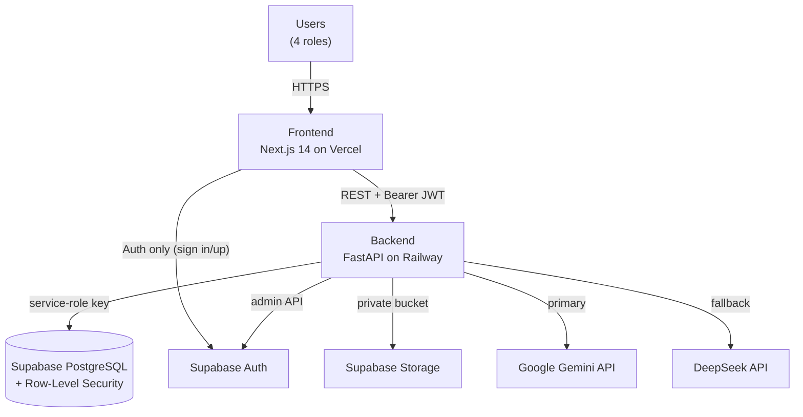
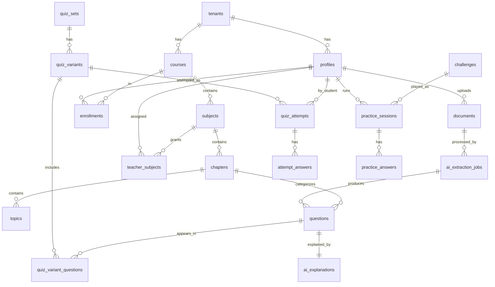

# ArivuPro Quiz Platform (quiz-generator-v1) — Technical Project Document

> **Purpose of this document.** A single, self-contained technical reference for the ArivuPro Quiz Platform. It is written so that **any technically literate reader — with no prior exposure to this codebase — can understand what the system is, how it is built, how it runs, what it costs, and how to extend it.** Technical statements were reviewed against `main` at commit `016830e` and the production deployment verified on 7 September 2026. Provider pricing and operational settings can change independently and must be rechecked before making financial or deployment decisions.

| | |
|---|---|
| **Product** | ArivuPro Quiz Platform — multi-tenant AI quiz generator for coaching institutions |
| **Repository** | `ArivuTechTeam/quiz-generator` |
| **Document version** | 1.1 |
| **Document date** | 7 September 2026 |
| **Basis** | `main` at `016830e`; Railway production deployment and migrations 11–12 verified |
| **Status of product** | Phase 1 (functional product + multi-tenant foundation) — **live in production pilot** |
| **Audience** | Engineering, technical leadership, prospective contributors, stakeholders |

---

## Table of Contents
1. [Executive Summary](#1-executive-summary)
2. [What the Product Is](#2-what-the-product-is)
3. [System Architecture](#3-system-architecture)
4. [Technology Stack (as deployed)](#4-technology-stack-as-deployed)
5. [Frontend Architecture](#5-frontend-architecture)
6. [Backend Architecture](#6-backend-architecture)
7. [Database Schema](#7-database-schema)
8. [Core Logic — How Key Features Work](#8-core-logic--how-key-features-work)
9. [Security & Multi-Tenancy](#9-security--multi-tenancy)
10. [Deployment & Environments](#10-deployment--environments)
11. [Cost Analysis](#11-cost-analysis)
12. [Known Gaps & Technical Debt](#12-known-gaps--technical-debt)
13. [Corrections vs the Original Specification](#13-corrections-vs-the-original-specification)
14. [Future Enhancements & Roadmap](#14-future-enhancements--roadmap)
15. [Glossary](#15-glossary)

---

## 1. Executive Summary

The ArivuPro Quiz Platform is a **multi-tenant SaaS web application** that lets coaching institutions turn teaching material into reviewed, student-ready quizzes using AI. A teacher uploads a PDF/DOCX; the system extracts the text, asks a Large Language Model (LLM) to generate questions across six question types and three cognitive levels; the teacher reviews/edits/approves them; students then take the quizzes and get auto-graded results, analytics, and a full practice/gamification suite (smart quizzes, daily challenges, exam simulator, leaderboards, challenge-a-friend).

**Architecturally**, it is a classic three-tier system built on managed cloud services:

- **Frontend:** Next.js 14 (React, TypeScript, Tailwind) → deployed on **Vercel**.
- **Backend:** FastAPI (Python) REST API → deployed on **Railway**.
- **Data & Auth:** **Supabase** (managed PostgreSQL + Auth + Storage).
- **AI:** **Google Gemini** as the primary LLM, with **DeepSeek** as an automatic fallback.

**Multi-tenancy** is built in from day one: every business table carries a `tenant_id`, PostgreSQL **Row-Level Security (RLS)** policies isolate each institution's data, and one shared deployment serves all institutions (no per-customer servers).

**Commercial status:** the product and its multi-tenant foundation are complete and live, but **billing/subscription enforcement is intentionally not yet built** (deferred to Phase 2). The database contains inert "scaffolding" (plan tiers, prices, usage counters) that no code currently enforces. See §12 and §14.

**Cost profile:** extremely low variable cost. A full ~20-question quiz generation costs roughly **₹1 (about US$0.012)** in AI spend; grading, analytics, and quiz-taking use **no AI at all**. At a 10-institution scale, total monthly infrastructure + AI cost is on the order of **₹10,000/month**, against a target price of ₹5,000–15,000 per institution per month — an ~80–90% gross margin. See §11.

---

## 2. What the Product Is

### 2.1 The problem it solves
Coaching institutions (CA / CMA / ACCA / commerce, and adjacent exam-prep markets) spend enormous manual effort creating practice questions. This platform automates the *generation* of questions from existing material while keeping a **human teacher in the loop** for quality control, then gives students a modern, gamified practice experience.

### 2.2 Who uses it (the four roles)
The application has one authoritative profile table (`profiles`) linked 1:1 to Supabase `auth.users`. There are four roles with distinct access scopes:

| Role | What they do |
|---|---|
| **super_admin** | Platform owner (ArivuPro). Onboards institutions (tenants), manages institution admins, sees cross-tenant analytics and AI-quality monitoring. |
| **institution_admin** | Manages one institution: creates teachers & students, manages courses/subjects, sees institution analytics. |
| **teacher** | Uploads material, generates quizzes, reviews/edits/approves/publishes questions, monitors their class. |
| **student** | Takes published quizzes, practises (smart quiz, daily challenge, exam simulator, challenges), tracks weak areas and progress. |

### 2.3 The business model (intended)
- **Who pays:** the **institution** (a tenant), not students.
- **How:** per-institution monthly subscription, target **₹5,000–15,000 / institution / month**.
- **Onboarding:** super-admin onboards an institution → institution-admin creates teachers and students. Public self-signup is available for students only; the database derives the tenant from the selected course and ignores browser-supplied role and tenant metadata.
- ArivuPro Academy is **tenant #1** — the first pilot customer — and is *not* special-cased in code.

---

## 3. System Architecture

### 3.1 High-level topology

```
                          ┌─────────────────────────────────────────────┐
                          │                   USERS                      │
                          │  super_admin · institution_admin · teacher · │
                          │                  student                     │
                          └───────────────────────┬─────────────────────┘
                                                   │  HTTPS (browser)
                                                   ▼
                        ┌──────────────────────────────────────────────┐
                        │   FRONTEND  —  Next.js 14 (React/TS/Tailwind) │
                        │   Hosted on VERCEL                            │
                        │   • Role-gated dashboard shell                │
                        │   • Talks to backend via REST (Bearer JWT)    │
                        │   • Talks to Supabase directly for AUTH only  │
                        └───────────┬───────────────────────┬──────────┘
                                    │                        │
                 REST + JWT (Bearer)│                        │ Supabase JS (auth only:
                                    │                        │ sign in/up, read own role)
                                    ▼                        ▼
        ┌───────────────────────────────────────┐   ┌───────────────────────────────┐
        │   BACKEND — FastAPI (Python)           │   │        SUPABASE (managed)      │
        │   Hosted on RAILWAY                    │   │   ┌─────────────────────────┐  │
        │   • Verifies Supabase JWT (ES256/JWKS) │   │   │  Auth (GoTrue)          │  │
        │   • Enforces role + tenant in code     │◄──┼───┤  PostgreSQL (+ RLS)     │  │
        │   • All business logic & AI calls      │   │   │  Storage (private docs) │  │
        │   • Uses service-role key (DB + Auth)  │   │   └─────────────────────────┘  │
        └───────────────┬───────────────────────┘   └───────────────────────────────┘
                        │  HTTPS (server-to-server)
                        ▼
        ┌───────────────────────────────────────┐
        │   AI PROVIDERS (LLM)                    │
        │   1. Google Gemini   (PRIMARY)          │
        │   2. DeepSeek        (FALLBACK)         │
        │   Called via raw HTTPS from backend     │
        └───────────────────────────────────────┘
```

### 3.2 The same picture as a Mermaid diagram (renders in GitHub/Typora/most MD→PDF tools)



### 3.3 Why this shape
- **Managed everything.** Supabase provides DB + Auth + Storage as one service, removing most ops burden. Vercel and Railway are push-to-deploy PaaS. A small team can run this with near-zero infrastructure maintenance.
- **One backend, one database, many tenants.** Onboarding a new institution creates a *row*, not a server. This is the standard, cost-efficient SaaS model and is the reason unit economics are strong (§11).
- **Human-in-the-loop AI.** The AI only *drafts* questions; nothing reaches a student until a teacher approves it. This is a deliberate quality/trust decision.

---

## 4. Technology Stack (as deployed)

| Layer | Technology | Version / detail | Hosting |
|---|---|---|---|
| Frontend framework | Next.js (App Router) | 14.2.35 | Vercel |
| Frontend language | TypeScript | 5.x | — |
| Styling | Tailwind CSS + shadcn/ui (Radix) | 3.4.1 | — |
| Charts / effects | Recharts, GSAP, html-to-image, @react-pdf/renderer | — | — |
| Package manager | pnpm | — | — |
| Backend framework | FastAPI | 0.141.1 | Railway |
| Backend server | Uvicorn | 0.52.1 | — |
| Backend language | Python | 3.12 (Docker image) | — |
| Database | PostgreSQL (via Supabase) | 15/16 managed | Supabase |
| Auth | Supabase Auth (GoTrue), JWT (ES256) | — | Supabase |
| File storage | Supabase Storage (private bucket) | — | Supabase |
| Primary LLM | **Google Gemini** — `gemini-2.5-flash` (generation), flash-lite tier (blueprint/topics/tutor) | — | Google |
| Fallback LLM | **DeepSeek** — `deepseek-chat` (OpenAI-compatible) | — | DeepSeek |
| PDF/DOCX extraction | pdfplumber, python-docx | — | — |

> **Important:** the historical project specification named DeepSeek as primary and Claude as fallback, and named SQLModel as the ORM. The **deployed code uses Gemini primary + DeepSeek fallback, has no Claude integration, and does not use SQLModel** (all DB access is via the Supabase client). See §13.

---

## 5. Frontend Architecture

### 5.1 Structure & rendering model
Next.js 14 **App Router**. Almost all dashboard pages are client components (`"use client"`) that fetch data at runtime from the backend. There is **no server-side rendering of business data** — the browser holds a Supabase session and calls the FastAPI API with the session's JWT.

### 5.2 Routing map (by role)

```
app/
├── login/page.tsx                       PUBLIC — sign in
├── signup/page.tsx                      PUBLIC — student self-registration by course
└── dashboard/
    ├── layout.tsx                       Role-gated shell (sidebar + topbar), loading gate
    ├── page.tsx                         Role router → per-role home
    │
    ├── super-admin/
    │   ├── page.tsx                     Platform overview (KPIs, activity, institutions)
    │   ├── institutions/page.tsx        Onboard & list institutions
    │   ├── admins/page.tsx              Manage institution admins
    │   ├── courses/page.tsx             Cross-tenant course / question-bank view
    │   └── ai-monitoring/page.tsx       "Question Quality" — AI generation health
    │
    ├── institution-admin/
    │   ├── page.tsx                     Institution overview
    │   ├── users/page.tsx               Create/list/delete teachers & students
    │   ├── courses/page.tsx             Manage courses & subjects
    │   ├── quizzes/page.tsx             Browse all quiz sets
    │   └── analytics/page.tsx           Institution analytics + findings
    │
    ├── teacher/
    │   ├── page.tsx                     Class overview + stats
    │   ├── subjects/page.tsx            Manage subjects & chapters
    │   ├── generate/page.tsx            Quiz generation wizard (blueprint)
    │   ├── review/page.tsx              Review queue (list of quiz sets)
    │   ├── review/[id]/page.tsx         Per-set review (approve/edit/reject/regenerate/publish)
    │   └── class-monitor/page.tsx       Roster + engagement + per-student report
    │
    └── student/
        ├── page.tsx                     Dashboard (stats, streak, charts, quick actions)
        ├── subjects/page.tsx            Subjects → chapters → practice entry
        ├── smart-quiz/page.tsx          Self-serve adaptive practice launcher
        ├── revision/page.tsx            Weak-topics to revise + bookmarks
        ├── weak-areas/page.tsx          Subject → Chapter → Topic accuracy tree
        ├── daily/page.tsx               Daily challenge + streak
        ├── challenge/page.tsx           Create "challenge a friend"
        ├── challenge/[token]/page.tsx   Accept challenge + challenge leaderboard
        ├── exam/page.tsx                Exam simulator (timed, negative marking)
        ├── leaderboard/page.tsx         Institution-scoped leaderboard
        ├── history/page.tsx             Past graded attempts
        ├── attempt/[id]/page.tsx        Take a published quiz
        └── practice/[id]/page.tsx       Take a practice/challenge/daily/exam session
```

### 5.3 Data layer
Two independent channels:

**(A) Backend REST API** — `frontend/lib/api.ts`
- Base URL from `NEXT_PUBLIC_API_BASE_URL`.
- `authHeader()` reads the Supabase session and attaches `Authorization: Bearer <access_token>` — the exact JWT the backend verifies.
- One typed helper `jsonRequest<T>()` for JSON, one `uploadDocument()` for multipart uploads.
- All response shapes are typed TypeScript mirrors of the backend's Pydantic models. Functions are grouped by feature (documents, generation, teacher review, student attempts, practice/engagement, academics, admin, super-admin, teacher analytics).

**(B) Supabase directly** — `frontend/lib/supabase.ts` (anon key, RLS applies)
- Used **only for auth**: `signInWithPassword`, student `signUp` (with `full_name` and `course_id`; legacy `tenant_id` is ignored by the hardened trigger), `getUser`/`getSession`, `signOut`, and reading the caller's own `profiles.role` for role-routing.
- **All business data goes through the FastAPI backend**, never direct table reads.

### 5.4 Auth & session flow
1. **Login** → `supabase.auth.signInWithPassword` → redirect to `/dashboard`.
2. **Role router** (`dashboard/page.tsx`) → reads `profiles.role` → redirects to the correct role home; unknown/missing profile → styled error with "Back to sign in".
3. **Shell gate** (`dashboard/layout.tsx`) → holds a branded skeleton loader until role resolves (no blank-sidebar flash); redirects to `/login` if there is no session. Forces a **change-password modal** for admin-created accounts (`must_change_password`).
4. Authorization for data is enforced **server-side** by the backend (Bearer JWT + role checks). Frontend gating is UX only.

### 5.5 Design system
- **Tokens** in `globals.css`: HSL CSS variables, brand green primary (`#2E8857`), `--radius: 0.75rem`, full light + dark themes.
- **Tailwind** maps utilities to those tokens; adds a brand green scale (50–950) and accent colors; `darkMode: ["class"]`.
- **Shared UI foundation** (`components/ui/`): `error-card`, `skeleton` (+ stats/list/cards variants), `empty-state` (icon + title + CTA), `icons` (inline SVG set), `brand` (logo + "Quiz Platform" lockup), `page-header`, plus shadcn primitives (`card`, `badge`, `button`, `input`, `label`). Motion utilities respect `prefers-reduced-motion`.
- **Dark mode** via a theme provider + pre-paint script (no flash).

### 5.6 Key reusable components
| Component | Role |
|---|---|
| `quiz-attempt.tsx` | Universal take-and-results engine for **all** attempt types (quiz, practice, challenge, daily, exam): questions, timer, submit, graded results, per-question AI tutor, PDF/share-card export. |
| `student-dashboard.tsx` | Student home: stats, streak, accuracy-over-time chart, quick actions. |
| `blueprint-generator.tsx` | Teacher generation wizard: upload → extract topics → assign weights + per-type counts → generate. |
| `question-review-card.tsx` | One reviewable question: inline edit, approve/reject, AI regenerate. |
| `course-manager.tsx` | Admin CRUD for courses & subjects. |
| `admin-manager.tsx` | Super-admin management of institution admins. |
| `teacher-stats.tsx` / `class-analytics.tsx` | Teacher KPIs and class performance. |
| `weak-area-analysis.tsx` | Student weakness tree (Subject → Chapter → Topic). |

---

## 6. Backend Architecture

### 6.1 Structure
```
backend/app/
├── main.py            FastAPI app, CORS, router mounting, /health + /me endpoints
├── api/               Role and feature router modules (HTTP endpoints)
├── services/          Business logic (generation, grading, selection, review,
│                      topics, blueprint, tutor, events, extraction) + services/llm/
├── lib/               config.py, supabase.py, auth.py, storage.py
└── models/            (empty — no ORM models; see §13)
```
- **CORS** allows the configured `FRONTEND_ORIGIN` plus any localhost port (dev). It is the only middleware; **authorization is per-endpoint** via FastAPI dependencies.

### 6.2 API surface (grouped)
Guards: **public** / **student** / **staff** (teacher+admin+super) / **admin** (institution_admin+super) / **super_admin**.

**System / identity (`main.py`)**
- `GET /health` — liveness (public)
- `GET /api/v1/me` — identity from JWT
- `GET /api/v1/me/profile` — tenant_id + role from `profiles`

**Documents** (`/api/v1/documents`) — `POST /upload` and `GET ""` are teacher-only by design. Limits: PDF/DOCX only, 150 MB, 5000-char preview.

**Quiz sets** (`/api/v1/quiz-sets`) — `POST /generate`, `POST /generate-blueprint`, `GET ""`, `GET /{id}`, `POST /{id}/publish`, and `POST /{id}/approve-all` are teacher-only by design.

**Questions** (`/api/v1/questions`) — `PATCH /{id}`, `POST /{id}/approve`, `POST /{id}/reject`, and `POST /{id}/regenerate` are teacher-only by design; `POST /{id}/explain` is available to a teacher for their own question or to a student after that question has been graded.

**Academics** (`/api/v1`) — `GET /public/courses` (**public**, feeds signup); `GET/POST /courses`, `POST /subjects`, `DELETE …` (read=staff, write=admin); `GET/PUT /teachers/{teacher_id}/subjects` (institution admin); chapters CRUD restricted to explicitly assigned teachers.

**Admin** (`/api/v1`) — user management (`/users` admin), institution onboarding & admin management (`/platform/tenants`, `/admins` super_admin), dashboards (`/admin/overview`, `/admin/analytics`, `/platform/overview`, `/platform/ai-monitoring`).

**Teacher** (`/api/v1`) — `/teacher/class-overview`, `/teacher/class-monitor`, `/teacher/student-report/{id}` (staff).

**Student** (`/api/v1`) — `/quizzes`, `/attempts` (start), `/attempts/{id}` (load), `/attempts/{id}/submit` (grade), `/student/stats`, `/student/weak-analysis`, `/student/revision-topics`, `/student/attempts` (all student).

**Practice** (`/api/v1`) — `/practice/sessions` (start/get/submit), bookmarks, `/daily` + `/daily/start`, `/exam/config` + `/exam/start`, `/leaderboard` (all student).

**Challenge** (`/api/v1`) — `/challenges` (create), `/challenges/{token}` (hub), `/challenges/{token}/accept` (student).

### 6.3 The AI / LLM layer (the heart of the product)
- **Two providers behind one interface** (`services/llm/`), both called via raw HTTPS (`httpx`):
  1. **Google Gemini** (`generativelanguage.googleapis.com`) — **primary**.
  2. **DeepSeek** (OpenAI-compatible chat completions) — **fallback**.
- **`complete_with_fallback(system, user)`** tries providers in order and returns the first success (with the provider name); if all fail it raises a clear error. Gemini is primary when `GEMINI_API_KEY` is set; DeepSeek is used if Gemini fails and `DEEPSEEK_API_KEY` is set.
- **Two Gemini tiers** (configurable by env):
  - `gemini-2.5-flash` — standard generation & regeneration (JSON response mode, temp 0.3).
  - flash-lite tier (`GEMINI_BLUEPRINT_MODEL`, default `gemini-3.5-flash-lite`) — blueprint generation, topic extraction, AI tutor (cheaper, temp ~0.2).
- **No embeddings / no vector search at runtime.** (A `vector(1536)` column exists on `questions` for future dedup, but nothing populates or queries it today.)
- **Text extraction:** `pdfplumber` (PDF) and `python-docx` (DOCX). **No OCR** — scanned/image PDFs are rejected with a clear error.

### 6.4 Services (core logic modules)
- **`generation.py`** — standard quiz generation pipeline (see §8.1).
- **`blueprint.py`** — weighted "blueprint" generation: converts High/Med/Low topic priorities into a 3:2:1 question mix, emphasises priority topics (~70% of questions), tags each question with its topic.
- **`grading.py`** — `grade_answer()` deterministic scoring per question type (see §8.2).
- **`selector.py`** — `select_question_ids()` — the shared question picker for all practice modes; always scopes to tenant + enrolled subjects + approved questions.
- **`review.py`** — assembles quiz-set detail; regenerates a single question in place.
- **`topics.py`** — extracts a de-duplicated list of teachable topics from a document.
- **`tutor.py`** — AI Tutor: one cached explanation per question, reused across all students.
- **`events.py`** — append-only event ledger writer; **never throws** (instrumentation must not break requests).

### 6.5 Auth model
- **JWT verification** (`lib/auth.py`): reads the token header; modern Supabase tokens are **ES256**, verified against the project's public keys fetched from the JWKS endpoint (cached). Audience `authenticated` is enforced.
- **Identity vs authority:** the user's `user_id`/`email` come from the token; the authoritative **`tenant_id` and `role` are read from the `profiles` table**, not from the token — so a user cannot forge their tenant or role at request time.
- **Provisioning:** public signup always creates a student, derives the tenant from a valid course, and ignores untrusted role/tenant metadata. Teacher and admin roles are created through authenticated backend provisioning and admin-created users must change their temporary password.
- **Database access uses the Supabase service-role key**, which **bypasses RLS**. Tenant isolation for API traffic is therefore enforced **in application code** via explicit `.eq("tenant_id", …)` filters on every query, with RLS as a defense-in-depth backstop (see §9 and §12).

---

## 7. Database Schema

PostgreSQL on Supabase. The repository baseline is `migrations/schema.sql` plus migrations 01, 02, and 04–12. There is no migration 03; migration 04 removed the abandoned seed-library feature. Apply migrations once, in numeric order, using `docs/deploy-runbook.md`.

### 7.1 Enums
`user_role` (super_admin, institution_admin, teacher, student) · `question_type` (mcq_single, mcq_multi, numerical, true_false, fill_blank, **descriptive**) · `question_source` (ai_generated, manual) · `review_status` (pending_review, approved, rejected, needs_edit) · `document_status` · `job_status` · `variant_type` (theory, practical, mixed) · `quiz_status` (draft, published, archived) · `attempt_status` (in_progress, submitted, graded, abandoned).

### 7.2 Tables by domain

**Tenancy & identity**
- `tenants` — one row per institution (name, subdomain, branding colors, `plan_tier`, `is_active`, `exam_config` jsonb).
- `profiles` — 1:1 extension of `auth.users`; holds authoritative `tenant_id`, `role`, name, and `must_change_password`. **This is the single application users table.**

**Academics** — `courses` → `subjects` → `chapters` → `topics` (a clean hierarchy, each cascading on delete) + `enrollments` (student course membership and derived teacher course membership) + `teacher_subjects` (the authorization source for each teacher's explicit subject access).

**Content & question bank**
- `documents` — uploaded files (storage path, type, status).
- `ai_extraction_jobs` — one row per AI processing run on a document (history for reprocessing).
- `questions` — the question bank: type, text, `options` (jsonb), `correct_answer` (jsonb), explanation, difficulty, marks, `source`, `review_status`, `topic_id`, and a (currently unused) `embedding` vector column.
- `quiz_sets` → `quiz_variants` → `quiz_variant_questions` — one upload produces a set; a set has variants (by cognitive level); a variant links to ordered questions.

**Student activity**
- Teacher-quiz path: `quiz_attempts` → `attempt_answers`.
- Self-serve practice path (added in migration-05): `practice_sessions` → `practice_answers`, plus `bookmarks`.
- `revised_topics` — topics a student marked "revised".
- `challenges` — a frozen, shareable question set (unique `share_token`); takers play as `practice_sessions` tagged with `challenge_id`.
- **There is no separate "daily" or "exam" table** — Daily Challenge, Exam Simulator, and Challenge-a-Friend are all `practice_sessions` distinguished by a `mode` string (+ `challenge_id`). Exam pattern config lives on `tenants.exam_config`.

**AI tutor** — `ai_explanations` (one cached explanation per question, reused across students).

**Instrumentation** — `events` (append-only ledger: actor, event_type, subject, metadata, timestamp; powers the AI-quality/analytics dashboards).

**Monetization scaffolding (NOT enforced)** — `plan_limits` (tiers + prices) and `tenant_usage` (a counter). See §12.

### 7.3 Entity-relationship (core entities)



### 7.4 The `tenant_id` fan-out
**Every application table except the global `plan_limits` carries `tenant_id`.** This is the backbone of multi-tenancy: it lets both RLS policies and application queries scope every read/write to one institution.

### 7.5 Migration timeline
| # | What it added |
|---|---|
| base `schema.sql` | Full v1 schema: enums, all core tables, helper functions, `handle_new_user` trigger, RLS on all tenant tables, 2 analytics views. |
| 01 enrollments | `enrollments` table; `quiz_sets.subject_id`; auto-enroll on signup when a `course_id` is provided. |
| 02 events | Append-only `events` ledger (+ read-only RLS). |
| 04 drop-seed-library | Removed the (abandoned) platform seed-question library. |
| 05 practice | `practice_sessions`, `practice_answers`, `bookmarks` — the self-serve practice engine. |
| 06 revised-topics | `revised_topics` (revision tracking). |
| 07 challenges | `challenges` + `practice_sessions.challenge_id`. |
| 08 exam-config | `tenants.exam_config` (per-institution exam pattern). |
| 09 dev-tenant | Development tenant bootstrap used by the established environment setup. |
| 10 plan-limits-rls | Plan-limit data and RLS hardening for monetization scaffolding. |
| 11 auth-hardening | Student-only public signup, course-derived tenant assignment, protected profile updates, forced temporary-password changes, and practice autosave state. |
| 12 teacher-subjects | Tenant-consistent `teacher_subjects`, assignment RLS, atomic assignment replacement, enrollment derivation, and backfill of existing teacher access. |

---

## 8. Core Logic — How Key Features Work

### 8.1 Quiz generation pipeline (standard)
```
Teacher uploads PDF/DOCX
        │
        ▼
[1] Store file in Supabase Storage (private bucket, path = tenant_id/uuid.ext)
        │
        ▼
[2] Extract text  (pdfplumber / python-docx)  → reject if empty (scanned PDF)
        │
        ▼
[3] Select material window (skip front-matter for long docs; cap ~60,000 chars)
        │
        ▼
[4] Build system + user prompt (exact JSON contract per question type & level)
        │
        ▼
[5] complete_with_fallback()  →  Gemini (primary)  →  DeepSeek (fallback)
        │
        ▼
[6] Validate LLM output (Pydantic), enforce per-question shape, truncate to N
        │
        ▼
[7] Persist: quiz_set (draft) → variant → questions (pending_review) → ordered links
        │
        ▼
Teacher reviews → approve/edit/reject/regenerate → PUBLISH  →  visible to students
```
- Before generation or chapter management, the backend verifies that the teacher is explicitly assigned to the selected subject through `teacher_subjects`.
- **Blueprint generation** is a richer variant: the teacher first extracts topics, assigns each a priority (High/Med/Low) and per-type question counts; the system converts priorities to a weighted mix and tags each generated question with its topic. This powers weightage-based question papers.

### 8.2 Grading (deterministic — no AI)
`grade_answer(question, student_answer)` returns `(is_correct, marks_awarded)`:
- **mcq_single / true_false:** exact match of the chosen option id.
- **mcq_multi:** **all-or-nothing** — the selected set must equal the correct set.
- **numerical:** correct if `|answer − value| ≤ tolerance`.
- **fill_blank:** normalized text match (lowercase, trimmed) against any accepted answer.
- **No answer / unknown type:** scored wrong (fail-closed). Grading uses **no AI**, so it is instant and free.

### 8.3 The practice engine (one engine, six modes)
A single pattern powers Smart Quiz, chapter practice, Daily Challenge, Exam Simulator, Challenge-a-Friend, and Revision:
1. `select_question_ids()` picks a question pool — **always** scoped to the student's tenant, their enrolled subjects, and **approved** questions only. The pool is shuffled and sliced to the requested count, then **frozen** into the session.
2. The chosen `question_ids` + a `config` (count, difficulty, time limit, negative marking) are stored on one `practice_sessions` row; the mode string distinguishes the experience.
3. The same `quiz-attempt` UI and the same grading function serve every mode, so behavior is consistent and there is no code duplication.
- **Negative marking** applies **only** in practice/exam sessions (frozen into the session config; a blank answer scores 0, exam totals are floored at 0).
- **Streaks** (Daily Challenge) are computed from consecutive completed days.
- **Exam pattern** (question count, duration, negative marking) defaults to `{50, 60 min, 0.25}` and is overridable per institution via `tenants.exam_config`.

### 8.4 AI Tutor (cached)
When a student asks "why?" on a question, the backend returns a cached explanation from `ai_explanations` if present; otherwise it makes **one** flash-lite call and caches the result. So each question is explained by the LLM **at most once, ever**, across all students — keeping tutor cost negligible.

### 8.5 Analytics & AI-quality dashboards (deterministic — no AI)
The institution analytics, teacher class monitor, and super-admin "Question Quality" cockpit are built from the `events` ledger and SQL aggregates. They compute severity-ranked, plain-language "findings" using deterministic rules — **no AI is used to analyze data**, so these dashboards are fast, free, and reproducible.

---

## 9. Security & Multi-Tenancy

- **Two enforcement layers:**
  1. **Database RLS** — tenant tables use policies that scope rows to `current_tenant_id()`, with role-aware rules (students see only *approved* questions in *published* sets; students read only their own attempts; the `events` ledger is append-only; etc.).
  2. **Application-level tenant filtering** — because the backend uses the **service-role key (which bypasses RLS)**, every backend query also filters by `tenant_id` explicitly. The authoritative `tenant_id`/`role` come from the DB `profiles` row, not the token, so they cannot be forged per request.
- **Auth:** Supabase JWT (ES256) verified via JWKS; audience enforced; JWKS cached.
- **Role provisioning:** public callers cannot select elevated roles. Institution admins and super-admins provision staff through tenant-scoped backend endpoints.
- **Teacher access:** teachers can generate content and manage chapters only for subjects present in `teacher_subjects`; tenant-consistent foreign keys reject cross-tenant assignments.
- **Storage:** private `documents` bucket; object paths namespaced by `tenant_id`.
- **Known caveat:** isolation for API traffic is *defense-by-convention* — a future endpoint that forgets its `tenant_id` filter would not be caught by RLS (because service-role bypasses it). This is called out as tech debt in §12.

---

## 10. Deployment & Environments

### 10.1 Topology
```
GitHub (ArivuTechTeam/quiz-generator)
     │  push / merge to main
     ├──────────────► VERCEL   → builds & deploys FRONTEND automatically (Root Dir = frontend)
     │
     └── (manual)  ──► RAILWAY  → backend deployed by `scripts/deploy.sh` from repository root
                                  (no GitHub auto-deploy for backend)

SUPABASE (dashboard-configured): Postgres + Auth + Storage — settings apply instantly
```

### 10.2 Deploy workflow (two tracks)
- **Frontend change:** push to GitHub → **merge PR to `main`** → **Vercel auto-deploys**. (`next build` runs ESLint and fails on lint errors — always run `pnpm build` locally before merging, not just `tsc`.)
- **Backend change:** from a clean, synchronized `main`, run **`./scripts/deploy.sh`**. It scopes Railway to `backend/` with `--path-as-root`; a bare `railway up` from the repository root is invalid for this service. Keep Railway's custom Start Command blank so the Dockerfile `CMD` expands `$PORT` correctly.
- **Supabase change:** dashboard settings (auth URLs, SMTP, RLS) apply immediately; schema changes are applied by running migration SQL in order.

### 10.3 Environment variables
**Frontend (browser-exposed, `NEXT_PUBLIC_*`):**
- `NEXT_PUBLIC_SUPABASE_URL`, `NEXT_PUBLIC_SUPABASE_ANON_KEY` (RLS-safe anon key)
- `NEXT_PUBLIC_DEFAULT_TENANT_ID` (ArivuPro tenant, signup default)
- `NEXT_PUBLIC_API_BASE_URL` (backend URL — **baked at build time**, so changing it requires a redeploy)

**Backend (secret):**
- `SUPABASE_URL`, `SUPABASE_ANON_KEY`, `SUPABASE_SERVICE_ROLE_KEY`, `SUPABASE_JWT_SECRET`
- `FRONTEND_ORIGIN` (CORS allow-list — the Vercel URL)
- `GEMINI_API_KEY` (+ optional `GEMINI_MODEL`, `GEMINI_BLUEPRINT_MODEL`, `GEMINI_BASE_URL`)
- `DEEPSEEK_API_KEY` (+ optional `DEEPSEEK_MODEL`, `DEEPSEEK_BASE_URL`)

> Secrets live in `.env` / `.env.local` (gitignored) and in the Vercel/Railway/Supabase dashboards. Never in code.

### 10.4 Email (SMTP) — current state
Email confirmation and password-reset emails require a custom SMTP provider (e.g. Brevo, free tier ~300 emails/day). Supabase's built-in sender is rate-limited and unreliable for real users. **SMTP is not yet configured**; for the current pilot, accounts are created by admins with temporary passwords, so email delivery is not on the critical path. This should be configured before public self-service launch.

---

## 11. Cost Analysis

> **Assumptions.** Prices were rechecked on **7 September 2026** against the official [Gemini](https://ai.google.dev/gemini-api/docs/pricing), [Supabase](https://supabase.com/pricing), [Vercel](https://vercel.com/pricing), and [Railway](https://docs.railway.com/pricing) pricing pages. USD→INR at **₹88 = $1** is illustrative; adjust it and provider usage before making a budget decision. Token estimates are derived from the actual code (material window + JSON output contract).

### 11.1 Gemini list pricing (models the code uses)
| Model | Input / 1M tokens | Output / 1M tokens | Used for |
|---|---|---|---|
| `gemini-2.5-flash` | **$0.30** | **$2.50** | Standard quiz generation & regeneration |
| `gemini-3.5-flash-lite` (flash-lite tier) | **$0.30** | **$2.50** | Blueprint generation, topic extraction, AI tutor |

*(Gemini offers a free tier with rate limits; the figures above are the paid tier used for planning at scale.)*

### 11.2 Cost per AI action (variable cost)
| Action | ~Input tokens | ~Output tokens | Cost (USD) | Cost (INR) |
|---|---|---|---|---|
| Standard quiz generation (~20 Q) | ~16,000 | ~3,000 | **~$0.012** | **~₹1.1** |
| Blueprint generation (~20 Q) | ~16,000 | ~3,500 | ~$0.013 | ~₹1.2 |
| Topic extraction (per document) | ~8,000 | ~500 | ~$0.004 | ~₹0.35 |
| AI tutor explanation (per question, **cached once**) | ~600 | ~300 | ~$0.001 | ~₹0.08 |
| **Grading / quiz-taking / analytics** | — | — | **$0 (no AI)** | **₹0** |

**Key insight:** the only AI cost is at *content creation* time (teacher generating quizzes) and one-time tutor explanations. All *student consumption* (taking quizzes, grading, analytics, leaderboards, practice) is **free of AI cost** because it's deterministic.

### 11.3 Monthly cost — worked examples
**One active institution (busy month):**
- 200 quiz generations × ₹1.1 = ₹220
- 200 topic extractions × ₹0.35 = ₹70
- 2,000 unique tutor explanations (cached) × ₹0.08 = ₹160
- **AI subtotal ≈ ₹450 / institution / month** (well under $10).

**Infrastructure (shared across all tenants):**
| Service | Pilot (free tiers) | Production (paid) |
|---|---|---|
| Supabase | ₹0 (Free) | ~₹2,200 ($25 Pro) |
| Vercel | ₹0 (Hobby) | ~₹1,800 ($20 Pro) |
| Railway (backend) | ~₹450–900 (usage) | ~₹1,800 (usage) |
| **Infra subtotal** | **~₹500–900 / month total** | **~₹6,000 / month total** |

**Blended estimate at ~10 institutions:** infra (~₹6,000) + AI (~₹4,500 for 10 tenants) ≈ **~₹10,000–12,000 / month total** — consistent with the original planning estimate.

### 11.4 Unit economics
At the target price of **₹5,000–15,000 / institution / month**, 10 institutions generate **₹50,000–150,000 / month** revenue against **~₹10,000–12,000** total cost →  **~80–90% gross margin**. The architecture (one shared deployment, deterministic student-side features, cached tutor, cheap flash models) is the reason costs stay low as tenants grow.

> **Caveat for stakeholders:** these are *infrastructure and AI* costs only. They exclude salaries, support, sales, and the (currently unbuilt) payment-processing fees. And note that **no billing is enforced yet** — the platform cannot *collect* this revenue until Phase 2 (see §14).

---

## 12. Known Gaps & Technical Debt

Presented honestly, as a forward-deployed engineer would to a new maintainer:

1. **No billing / monetization enforcement.** The DB has `plan_limits` (free/starter ₹2,999/growth ₹9,999/enterprise) and `tenant_usage`, plus `tenants.plan_tier`/`is_active` — but **no code reads or enforces any of it**. There is no payment gateway, no subscription tables, no "suspend an unpaid tenant" logic. It is currently a free, open app with billing *scaffolding* only.
2. **RLS is a backstop, not the primary guard for API traffic.** The backend uses the service-role key (bypasses RLS); isolation depends on every query including a `tenant_id` filter. A missed filter in a future endpoint would leak cross-tenant data. Consider a shared query helper or using the RLS-respecting client for user-scoped reads.
3. **Instrumentation gaps.** Standard generation does not emit a `question.generated` event (only blueprint does), and `DOCUMENT_UPLOADED` is never emitted — so some AI-monitoring numbers undercount.
4. **Dead/unused code.** A PYQ (past-year-questions) parser and the RLS-respecting anon DB client exist but are unwired; the `questions.embedding` vector column is unused (no dedup yet).
5. **SMTP not configured.** Email confirmation/reset won't deliver until a provider (e.g. Brevo) is set up.
6. **Bundle size.** The quiz-attempt/practice/class-monitor routes are heavy (~640 kB first load) because they pull in Recharts + the PDF renderer; lazy-loading these is a quick win.

---

## 13. Corrections vs the Original Specification

The historical project specification described some choices that the **deployed code does not match**. This document reflects the code. The differences:

| Topic | Original spec said | Deployed reality |
|---|---|---|
| Primary LLM | DeepSeek V4 | **Google Gemini** (`gemini-2.5-flash`) |
| Fallback LLM | Anthropic Claude Sonnet | **DeepSeek** (`deepseek-chat`); **no Claude code exists** |
| ORM | SQLModel | **No ORM** — all DB access via the Supabase (PostgREST) client |
| Question types | 6 incl. `matching` | Enum has `descriptive`, **not `matching`** |
| OCR | Planned | **Dropped** — Gemini-only, no OCR (scanned PDFs rejected) |
| Font | Plus Jakarta Sans | **Inter** is actually loaded |
| Icons | — | `lucide-react` installed but a **hand-rolled inline SVG set** is used |

These are not bugs — they are the result of pragmatic decisions during the build. They are documented here so a new engineer trusts the code over the old spec.

---

## 14. Future Enhancements & Roadmap

### 14.1 Phase 2 — Commercialization (to actually charge money)
This is the biggest missing block for a "real SaaS":
1. **Payments integration** — Razorpay (India-first) or Stripe: checkout + webhooks.
2. **Subscription & billing tables** — `subscriptions(tenant_id, plan_tier, status, current_period_end, provider_ids…)`, `invoices`, `payments`.
3. **Access-window columns on `tenants`** — `status` (active/trialing/past_due/suspended), `trial_ends_at`.
4. **Enforcement** — a FastAPI dependency that blocks inactive/expired tenants at auth time; quota checks that read `plan_limits` and write `tenant_usage`.
5. **Paywall/feature-flag UI** — plan-gated features and upgrade prompts.

### 14.2 Access-control follow-up
- Student-only public signup and the hardened `handle_new_user` trigger are deployed. Future work may add invite codes, admin approval, and explicit session revocation for stricter onboarding control.

### 14.3 Product enhancements (from scope + observed opportunities)
- **Self-service institution onboarding** and per-institution subdomains / white-labeling.
- **Question dedup** using the existing `embedding` column (semantic similarity).
- **PYQ (past-year-questions) ingestion** — the deterministic parser exists but is unwired.
- **Adaptive difficulty** and a full **AI Tutor chat** experience.
- **Excel import/export**, richer analytics, and a **revision scheduler** (spaced repetition).
- **Email/notifications** (SMTP + digests) and in-app announcements.

### 14.4 Engineering hardening
- Shared tenant-scoped query helper (or RLS-respecting client) to make isolation defense-in-depth.
- Complete the events instrumentation (emit on standard generation + uploads).
- Lazy-load heavy client bundles (charts, PDF).
- Expand the backend security-regression suite with Supabase integration tests and add frontend unit/e2e coverage.
- Require the existing backend-test and frontend lint/build GitHub Actions checks in the `main` branch ruleset.

---

## 15. Glossary

| Term | Meaning |
|---|---|
| **Tenant** | One institution (customer). Every business row belongs to a tenant via `tenant_id`. |
| **RLS (Row-Level Security)** | PostgreSQL feature that filters which rows a query can see/modify, enforced by the database. |
| **Service-role key** | A Supabase admin key that **bypasses RLS**; used by the backend, which then filters by tenant in code. |
| **JWT / ES256 / JWKS** | The signed token proving a user's identity; ES256 is its signature algorithm; JWKS is the endpoint serving the public keys to verify it. |
| **Quiz Set / Variant** | One upload creates a *set*; a set has *variants* (by cognitive level: theory/practical/mixed); a variant links to ordered questions. |
| **Blueprint** | A weighted generation mode where the teacher assigns topic priorities and per-type counts. |
| **Practice session** | A frozen set of questions a student practises; one table (`practice_sessions`) powers smart quiz, daily, exam, challenge, and revision via a `mode` field. |
| **Fallback (LLM)** | If the primary AI provider (Gemini) fails, the backend automatically retries with the secondary (DeepSeek). |
| **Findings** | Deterministic, plain-language insights on the analytics dashboards — computed by rules, not AI. |

---

*End of document. Prepared from a direct review of the deployed codebase (frontend, backend, database schema, and migrations) and current provider pricing. For questions or to extend the platform, start with §6 (backend), §7 (schema), and §8 (core logic).*
