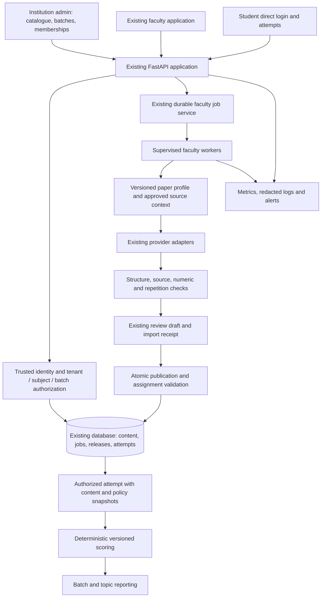

# ArivuPro Quiz Platform — Phase 6 Engineering Handover

**Status:** implementation specification; Phase 6 is not implemented by this document.  
**Prepared:** 22 September 2026.  
**Audience:** incoming engineer, technical lead, or coding LLM with repository access.  
**Repository:** `quiz-generator-v1`; reviewed branch `changes-pavyaa`; base HEAD `bd3c5963665d2419b74709e4b3585a8abc551a21`, plus the existing uncommitted working tree.  
**Owner instruction:** research/documentation only until explicit permission to start coding. Never commit or push without separate approval. This report does not authorize deployment or database changes.

## 1. What has been built so far

Read this section before implementing anything. “Implemented” means present in the inspected working tree or its implementation records, not independently verified in a live deployment today. Earlier implementation documents describe different points in history and sometimes different migration numbers.

| Area | Existing work | Evidence and remaining boundary |
| --- | --- | --- |
| Application foundation | Next.js faculty/student/admin interfaces; FastAPI backend; Supabase identity, database and private source storage; tenant, course, subject, chapter and topic hierarchy | `frontend/`, `backend/app/`, `migrations/schema.sql`. Hosted configuration was not audited for this report. |
| Generate quiz | Source upload, topic analysis, blueprint allocation, question generation, validation, review and publication | `api/quiz.py`, `services/blueprint.py`, generation/prompt/validation services. Generic subject prompts need commerce context. |
| Extract quiz | Existing MCQ-document import, candidate validation, import receipts, source-question inventory and conservative answer-key matching | `services/quiz_extraction.py`, extraction services and Phase 3 record. Supported-layout limits remain; no universal completeness guarantee. |
| Review | Edit, approve, reject, regenerate and optional AI evidence/warnings; unchanged saves do not become false verification | `api/questions.py`, `services/review.py`, review frontend. See the approval discrepancy below. |
| Archive | Archive and restore availability without deleting quiz content | `api/quiz.py`; preserve existing review navigation and archived-quiz workflow. |
| Background work | Durable faculty queue for principal final-generation/import paths, idempotent submissions, leases, checkpoints, cancellation and atomic result persistence | `services/faculty_jobs.py`, `faculty_worker.py`, migration 43. Owner accepted Phase 2, but later reported timeouts. Actual current route/worker configuration and live recovery still need proof. |
| Source fidelity | Numbered-question reconciliation, distant answer-key handling, original-source verification context, bounded candidate repair | [Phase 3 record](faculty-pilot-phase-3.md). Repair is not implemented uniformly across every legacy route. |
| Student delivery | Published quizzes, attempts, autosave, scoring, snapshots and student performance endpoints | `api/student.py`, `services/grading.py`, migration 37. Present grading does not establish official examination simulation. |
| Safe reuse | Duplicate as draft with independent questions, lineage, idempotency, stale-write detection and protected publication | `services/quiz_reuse.py`, migration 47. **Owner explicitly tested duplication successfully.** Searchable question library and saved templates are not part of this completed increment. |
| Existing visual support | Owner's alternative figure extraction/linking implementation is present | Figure services and migrations 45/46. Preserve it and test compatibility. **Do not rebuild Phase 4.** End-to-end visual completeness is not claimed here. |
| Operational foundation | AI-call logging, read-only deployment preflight, backend/frontend CI, isolated queue/reuse transaction checks | `ai_call_logging.py`, `deployment_check.py`, `.github/workflows/ci.yml`, `scripts/`. These are not proof of live capacity, restore readiness or accurate billing. |

### 1.1 Honest completion status

Phase 6 is the next agreed delivery scope. It is inaccurate to say every requirement from all earlier roadmaps has been completed. Historical Phase 0 faculty baselines, searchable question-library functionality, named templates and some live operational checks remain unfinished or unverified. Library/templates are deferred unless the owner explicitly adds them to this scope; unresolved reliability, authorization and history-integrity issues are included here because they affect rollout.

The Phase 5 implementation record reports 526 backend tests and 117 subtests passing, frontend build/lint checks and isolated database tests. These are **historical results**, not tests rerun for this documentation task. PGlite uses a single connection; real multi-connection races and hosted PostgREST behaviour remain separate tests.

The working tree contains substantial modified and untracked implementation files. A clone of HEAD alone may not contain the features described above. Before handover execution, compare `git status --short` with the delivered workspace. Obtain owner approval before packaging through a commit/push; do not reset, clean or overwrite existing work.

### 1.2 Approval-policy discrepancy to resolve

The owner requested straightforward individual approval and Approve all for generated/imported questions, without mandatory explanation notes. Individual approval currently supports flagged items, but `api/quiz.py::approve_all_questions` still restricts bulk approval to `verification_status = verified`. The current approval document confirms that behaviour. Do not describe unrestricted bulk approval as already delivered.

**Phase 6 target:** bulk approval covers structurally valid pending/needs-edit questions within the teacher's authorized quiz, including AI-flagged questions. Keep rejected items excluded. Record teacher/time and return actual approved/skipped counts. Preserve original AI findings; teacher approval is not AI verification. Reject stale revisions and invalid answer structures. Do not require a review note. Publication stays a separate explicit action. Verify review and publication eligibility use compatible rules.

## 2. Product objective and fixed decisions

Deliver a **reusable commerce assessment vertical**, not a single-institution tool. Phase 1 proves that vertical on **two real commerce tenants at once**: **ArivuPro Academy** (tenant 1, our own commerce academy) and **one external commerce academy** (the first paying customer), each across its active batches with direct student login. Faculty should spend less time creating and checking usable quizzes; students must receive the right assessment and stable scoring for their batch. Success is that the *same* product serves the second commerce tenant through configuration only — no per-tenant code.

**Commerce is a configurable vertical, not hardcoded code.** "Optimize the platform for commerce" means shipping a reusable **Commerce Vertical Pack** — commerce question types, a tested numeric-check registry (interest, depreciation, break-even, percentages), commerce prompt modules, and CA/CS/CMA/ACCA paper-profile templates — applied per tenant as versioned defaults. ArivuPro is the pack's first instantiation; the external academy is the first onboarding. Never branch application logic on a specific tenant's name or ID; branch only on tenant-scoped configuration.

Confirmed by the owner:

- Commerce is the product vertical; ArivuPro is tenant 1 and one external commerce academy is the first external customer in Phase 1.
- All active batches of each tenant are in scope; students log in directly (no learner-portal integration required for the pilot).
- Preserve current workflows and the owner’s alternative visual implementation.
- Do not rebuild Phase 4; do not impose mandatory AI-warning resolution essays.
- No implementation, commit or push is authorized by the handover request.

Proposed default pending product confirmation: start with chapter practice for all configured batches of both tenants. Enable an examination-pattern mode only for a paper whose format and scoring rules have been separately verified and supported. Onboarding a tenant does not imply that every official question format is supported.

**Architecture decision:** use tenant-scoped, versioned commerce settings on the existing application, instantiated per tenant from the Commerce Vertical Pack. Keep tenant authorization and reusable core services intact. A course selection must never give one tenant access to another tenant's material — and cross-tenant isolation between the two live tenants is a launch-blocking test, not a hypothetical.

Out of scope: Phase 4 rebuild, LMS/SSO integration, payment-system replacement, proctoring, a new AI provider architecture, model fine-tuning, universal descriptive-answer grading, the deferred Phase 5 question library/templates, and — for Phase 1 — official-pattern mock versioning (paper-profile versioning beyond a single active profile per subject). Assess existing attachments for compatibility without replacing their implementation.

### 2.1 Onboarding a commerce academy (repeatable)

Because the vertical is sold to academies, onboarding a new commerce tenant must be a documented, repeatable runbook — not a bespoke build. Target steps for tenant #2 and beyond:

1. Provision the tenant and apply Commerce Vertical Pack defaults (question types, numeric checks, prompt modules, paper-profile templates) as versioned, tenant-scoped configuration.
2. Map the academy's actual courses/subjects onto the pack's CA/CS/CMA/ACCA templates with a preview; never auto-rename or reuse another tenant's IDs.
3. Import batches and memberships with a duplicate/conflict preview; assign faculty subject/batch permissions.
4. Smoke-test cross-tenant isolation against tenant 1: no shared documents, questions, keys, drafts or reports.
5. Dry-run assignment visibility with test student/teacher accounts in different batches before enabling restricted delivery.
6. Enable practice mode; defer official-pattern mode until that academy's paper rules are separately verified.

Record what was enabled per tenant and per paper. The first external onboarding is the true test that "commerce" is a product, not an ArivuPro configuration; onboarding effort and any pack gaps found during it are Phase-1 exit evidence.

## 3. Research report and implications

Research accessed 22 September 2026. Public pages establish advertised offerings; they do not establish internal batch rosters, permissions, material rights or expected concurrent usage.

| Finding | Source | Engineering implication (our recommendation) |
| --- | --- | --- |
| ArivuPro advertises CA, CS, CMA India, CMA USA, ACCA and other finance qualifications, several delivery modes, chapter-wise tests and examination-attempt-specific batches | [ArivuPro Academy](https://www.arivupro.com/) | Model qualification/level/paper and batch explicitly. “Commerce” alone is insufficient AI context. |
| ArivuPro One combines B.Com with professional qualification coaching | [ArivuPro One](https://www.arivupro.com/arivupro-one) | Keep university curriculum and professional curriculum distinct; allow a student to belong to multiple relevant batches. |
| CA Foundation includes Accounting, Business Laws, Quantitative Aptitude and Business Economics | [ICAI Foundation curriculum](https://www.icai.org/post/foundation-nset) | Commerce mode must preserve appropriate numerical/mathematical question support. |
| ACCA publishes Management Accounting syllabus guides for defined periods, including September 2026–June 2027 | [ACCA syllabus guide](https://www.accaglobal.com/gb/en/student/exam-support-resources/fundamentals-exams-study-resources/f2/syllabus-study-guide.html) | Persist syllabus applicability and exam-session context; do not silently update old questions when a new syllabus arrives. |
| Supabase access depends on both grants and row policies; privileged service access requires separate server-side authorization | [Supabase RLS documentation](https://supabase.com/docs/guides/database/postgres/row-level-security) | Test database grants/RLS and every privileged API/RPC. UI filtering is insufficient. |

Use exam-body publications plus faculty sign-off to establish actual paper rules. Do not derive negative marking, duration, pass rules or statutory applicability from marketing pages. This research has not verified every qualification's current examination regulations. Do not automatically ingest public course materials merely because a link is available; use approved materials provided for this project.

The Supabase changelog Markdown endpoint could not be fetched through the research browser. No database implementation was undertaken. The implementing engineer should verify current applicable platform/CLI documentation before migration work.

## 4. Repository map and findings that drive the design

Paths below are relative to the repository root.

| Concern | Start reading | Required extension or verification |
| --- | --- | --- |
| Identity and authorization | `backend/app/lib/auth.py`, `migrations/schema.sql`, teacher-subject migrations | Preserve trusted profile-derived tenant and role; add batch membership checks. |
| Faculty routes | `backend/app/api/quiz.py`, `extraction.py`, `faculty_jobs.py`, `questions.py` | Carry immutable commerce context through submission/recovery/review. |
| AI pipeline | `backend/app/services/blueprint.py`, `quiz_prompts.py`, `blueprint_prompts.py`, `extraction_prompts.py`, `question_validation.py`, `question_verification.py`, `question_repair.py` | Add versioned paper instructions and supported deterministic commerce checks. |
| Background execution | `faculty_jobs.py`, `faculty_worker.py`, `generation_jobs.py`, `backend/app/lib/config.py` | Verify the route chosen by each frontend flow. Some legacy work is still in-process. |
| Publication/reuse | `backend/app/services/quiz_reuse.py`, `migrations/migration-47-safe-quiz-reuse.sql` | Extend existing transaction/revision guarantees; do not create a competing publication system. |
| Student visibility and answers | `backend/app/api/student.py`, `services/student_access.py`, `api/practice.py`, `api/challenge.py` | Current quiz listing uses course enrolments and published subject quizzes. Enforce new assignment restrictions across every route, including direct IDs and practice. |
| Grading | `backend/app/services/grading.py` | Currently full marks or zero; numerical float/tolerance comparison. No general descriptive grader, despite a descriptive enum in the base schema. |
| Review UI | `frontend/app/dashboard/teacher/review/[id]/page.tsx`, `frontend/components/teacher/question-review-card.tsx` | Resolve bulk-approval mismatch; retain straightforward review. |
| Generate UI/API | `frontend/components/teacher/blueprint-generator.tsx`, `frontend/lib/api.ts` | Default settings from batch/paper; topic blueprint remains optional. |
| Operations | `deployment_check.py`, `ai_call_logging.py`, `account_deletion.py`, `backend/app/main.py` | Verify readiness, retention/deletion, recoverability and durable critical events. |

Historical reference documents: [original Phase 5/6 plan](phase-5-6-production-plan.md), [Phase 5 reuse](phase-5-safe-quiz-reuse.md), [Phase 2](faculty-pilot-phase-2.md), [Phase 3](faculty-pilot-phase-3.md), [approval policy](faculty-approval-workflow.md), [local worker](local-faculty-worker.md). This report supersedes their *future Phase 4* plans; the two-tenant scope — ArivuPro plus one external commerce academy — is intentionally retained, not superseded. Historical implementation facts remain useful.

## 5. Target architecture



Keep the current frontend, API, database and worker deployment units. No new microservice or vector database is required by this scope. Extend the existing queue rather than adding a third execution mechanism. If analysis/regeneration cannot use durable execution initially, document their supported limits and recovery behaviour; do not claim all AI operations are restart-safe.

### 5.1 Invariants

1. Every new academic, assignment and diagnostic record is scoped by `tenant_id`.
2. Same-tenant foreign keys and authorization prevent cross-tenant object substitution.
3. Teacher subject permission and batch assignment are checked at submission and commit; cached context does not override revoked access.
4. Source, syllabus, prompt, validator and policy versions remain traceable through a published question and an attempt.
5. A retry of one logical submission creates at most one persisted quiz. Provider calls can repeat before checkpoints; do not promise exactly-once provider billing.
6. Published content and historical scoring inputs are immutable. Corrections produce a new draft/release; any future regrade must be an explicit audited operation.
7. An AI warning and a faculty review decision are different facts.
8. Hidden answers remain unavailable through alternate routes, source downloads, practice pools and copied-question lineage.

## 6. Proposed data model

These are logical contracts, not executable SQL. Reuse existing entities where they already represent the concept. Reconcile the deployed schema before choosing migration filenames or final physical names.

### 6.1 Academic model

Retain `courses -> subjects -> chapters -> topics`. Prefer mapping an existing course to a qualification/level and an existing subject to a paper. Never rename or replace existing IDs automatically. A B.Com course also needs awarding-university/programme context rather than a fabricated professional-qualification mapping.

| Proposed entity | Required fields and rules |
| --- | --- |
| `course_profiles` | `tenant_id`, existing `course_id`, qualification/awarding body, level, programme variant, active state. One current mapping per course; mapping changes cannot relabel old releases. |
| `paper_profile_versions` | `id`, `tenant_id`, `subject_id`, version, syllabus identifier, applicability/session range, jurisdiction, accounting framework where relevant, currency/unit conventions, supported question types, prompt/check versions, source references, approver/time, draft/active/retired state. Active versions immutable; update by creating another version. |
| `batches` | `id`, `tenant_id`, `course_id`, name, branch/delivery-mode labels, target exam session, active dates/status. A branch is not automatically a separate tenant. |
| `batch_papers` | Batch, subject and explicit active paper-profile-version association. Unique batch/subject pair. Profile subject and course must match. |
| `batch_memberships` | Batch, profile, membership role, active state and validity dates. Unique batch/profile pair; student may belong to multiple batches. Teacher access additionally requires existing subject permission. |
| Document context | Link document to a reviewed paper profile with source checksum/version, applicable year when relevant, and faculty-confirmed classification. Preserve existing source-file IDs and access rules. |
| Question provenance | Extend existing source/lineage fields with profile version, generation/check versions, numeric-check result and source references. Do not require fabricated metadata for legacy questions. |

Index common lookups on tenant plus course, subject, batch/member and active state. Use constrained typed columns for relationships/access controls; bounded versioned JSON can hold paper-specific generation defaults. Validate JSON through backend schemas. Do not put access decisions inside arbitrary prompt configuration.

### 6.2 Assessment and assignment model

| Proposed entity | Required fields and rules |
| --- | --- |
| `assessment_policy_versions` | Tenant, version, practice/mock mode, supported types, scoring rules, time limit, attempt limit, feedback release rule, optional exam-rule source and academic approver. Immutable after release. |
| Release binding | Existing quiz release binds a paper-profile version and assessment-policy version. Extend the existing atomic publication transaction; avoid a second mutable copy of release state. |
| `quiz_assignments` | Tenant, released quiz reference, batch, availability window, status and policy binding. Idempotent creation. Scheduling alone must not alter frozen paper content. |
| Attempt extensions | Assignment/release/profile/policy identity; immutable effective policy snapshot; server start/deadline; scoring-engine version. Preserve existing question snapshot. |

Do not infer batch membership from matching names. Admin imports must preview additions, duplicates and unmapped rows before applying. Keep course enrolment consistent with batch membership through one transaction/service; course enrolment alone must not grant batch-restricted access.

For legacy quizzes, preserve current behaviour until their explicit migration decision. Introduce an explicit audience mode such as `legacy_course` versus `assigned_batches`; new commerce quizzes use `assigned_batches`. Never use “no assignment exists” as an accidental public/course-wide fallback for a restricted quiz. Record the mapping decision before enabling strict mode for existing material.

## 7. User workflows

### 7.1 Admin setup — once, then maintain

1. Confirm the actual course/level/paper/batch roster with an academic coordinator.
2. Map existing course and subject IDs; preview conflicts instead of creating duplicates.
3. Create and academically approve versioned paper profiles and practice defaults.
4. Assign faculty subjects/batches and import student memberships with a preview.
5. Test direct login for teacher/student accounts before inviting all users.
6. New exam sessions get new applicable profile versions; historical releases retain their original context.

### 7.2 Generate from teaching material

1. Faculty selects batch and paper; assigned/default batch can be preselected.
2. Upload or select an authorized source. System suggests source classification; faculty corrects uncertain critical context once.
3. Select question count and difficulty. Course defaults supply type mix and other settings; advanced topic allocation is optional.
4. Submit one durable job using a stable request key. Return job ID promptly and show its real stage; refresh reconnects to the job.
5. Worker resolves immutable context, retrieves relevant approved source sections, generates, validates and performs bounded repair where supported.
6. Save the draft atomically. Report requested/produced counts and genuine coverage limitations; never fill gaps with unrelated syllabus material.
7. Faculty reviews, edits or bulk approves, then publishes to selected authorized batches.

“Automatic coverage” means allocating across identified, source-supported topics; it must not be labelled complete syllabus coverage without an independent mapped syllabus and measured coverage. Faculty can override allocations without rebuilding a blueprint manually for every upload.

### 7.3 Extract an existing question paper

1. Select batch/paper and upload the MCQ document, with an optional separate answer key if that input is implemented and validated.
2. Preserve wording, numbering, option order, numerical data and existing figure associations through the current implementation.
3. Independently reconcile recognized source items and answer keys where supported. Preserve duplicate occurrences from different sections.
4. Record answer provenance as source key, model-inferred or faculty-corrected. Keep disagreements visible; never silently replace a supplied key with model opinion.
5. Show a short receipt: imported, skipped, key conflicts and unrecognized-layout limitations, with optional detail. Missing answers remain explicit unresolved candidates; do not invent valid answers to satisfy the schema.
6. Review/Approve all uses the same simple policy as generation. Missing/invalid answer structures still require correction before publication.

The extraction service must not regenerate or paraphrase questions as a way to hide extraction failures. A zero recognized inventory count means unknown coverage, not an empty source document.

### 7.4 Publication and student attempts

1. Publishing validates current draft revision, approved answer shapes, teacher permissions, profile/policy compatibility and target batches.
2. Persist the release and its initial assignments atomically, or use an explicit non-visible intermediate state with an idempotent completion transaction. No partial publication to the wrong audience.
3. Student list and attempt-start endpoints enforce tenant, active membership, assignment window, published availability and attempt limit.
4. Attempt start atomically snapshots content, scoring policy and deadline. Concurrent starts must not exceed the limit.
5. Autosave is authorized and revisioned. Submit is idempotent and server-timed. Resume uses the original deadline and policy.
6. Results and explanations follow the snapshot's feedback-release rule across every API and export path.
7. Archive prevents new starts. Proposed default: already-started attempts can finish to their original deadline; membership revocation may block further access under the explicitly documented security policy. Test and confirm this behaviour before changing existing semantics.

Duplicate as draft must retain useful content/provenance but not inherit live assignments, student attempts or schedules. Require selection/confirmation of destination batch/profile applicability.

## 8. Commerce AI specification

### 8.1 Input contract

Every new commerce job records validated identifiers for tenant/actor, batch, subject, paper-profile version, document version/hash, generation mode, question count/types, difficulty, optional topic selections, prompt version and request key. Resolve tenant/actor from trusted identity, not client claims. Freeze the effective configuration at submission so an admin edit cannot change a job midway.

Sources are untrusted data. Instructions inside an uploaded document must not override system constraints, request secrets, change tools or cause unrelated retrieval. Restrict source selection to documents authorized for the tenant/user and academic context. No silent general-web fallback for missing syllabus content.

### 8.2 Output and validation contract

Retain existing question schemas and extend metadata without breaking readers. Each candidate needs type, stem, options where applicable, answer, marks, explanation where supported, topic/source reference, answer provenance and machine-check outcomes. Validate schema before persistence. Distinguish:

- `source_evidence_missing`: evidence could not be established; not automatically outside the syllabus.
- `syllabus_context_conflict`: explicit version/jurisdiction mismatch.
- `numeric_check_failed`: independently evaluated supported calculation disagrees.
- `answer_key_conflict`: source key and inferred answer disagree.
- `possible_duplicate`: repeated learning task in generated content; do not delete imported occurrences automatically.
- `structure_invalid`: no valid answer representation; correction required.

Map to existing warning storage where practical; introduce a versioned warning vocabulary rather than repurposing review statuses. Verification is fallible, so retain evidence and show faculty approval separately.

### 8.3 Numerical correctness

Implement a bounded registry of tested calculators only for approved problem families, initially selected from actual faculty fixtures. Candidates include percentages, simple/compound interest, straight-line depreciation and break-even calculations. These are examples, not a promise of universal accounting validation.

Use decimal arithmetic for monetary calculations and explicit units, currency scale, rounding mode, rounding stage and tolerance. For example, 2.5 lakh and 250000 rupees may be equivalent only when the declared unit contract allows that conversion. Distinguish 12 percent from 0.12 using the expected unit, not guesswork. Reject non-finite numbers and invalid tolerances. Do not execute Python/SQL/code produced by the model. Unsupported calculations receive `not_checked`, never a false success.

A numerical checker must recompute from independently parsed/validated inputs or a faculty-labelled fixture. Comparing the model's final answer to its own explanation is not independent verification. Check generated options for equivalent duplicate values and ensure the designated answer matches the recomputation.

### 8.4 Law, taxation and accounting context

Relevant profiles carry jurisdiction, applicable financial/assessment year, amendment cutoff and accounting framework. Ask for missing critical context at profile/source setup, not per question. Never assume model memorization reflects the uploaded source's effective rules. For conflicting sources, show the conflict and require academic resolution before enabling an official-pattern profile. Ordinary review warnings remain non-blocking for valid practice questions under the owner’s approval policy.

### 8.5 Prompt and provider management

Keep existing provider adapters and obtain real model identifiers from configuration. Use course-specific instruction modules, source constraints and evaluated examples. Version prompt changes and evaluate by paper and workflow. Bound provider timeouts, concurrency, token budgets and repair attempts. Do not increase retries until symptoms disappear. Track first-pass output separately from repair output and include all calls in cost measurement.

## 9. Scoring and exam-mode contract

Default new practice policies preserve full-mark/zero behaviour unless explicitly configured otherwise. Add negative marking only through an academically approved paper policy. Keep numerical input interpretation separate from financial calculation verification.

Proposed scoring rules:

- Single choice/true-false: full configured marks for the correct identifier; otherwise configured wrong-answer penalty; blank uses an explicit omission rule.
- Multiple choice: exact-set scoring initially; no partial credit unless separately specified, implemented and tested.
- Numerical: finite parsed value, declared units, decimal rounding/tolerance policy; no arbitrary percentage/currency stripping.
- Fill blank: explicit accepted answers and documented normalization, preserving meaningful financial notation.
- Descriptive/journal-entry/working-step answers: do not enable automatic grading merely because a database enum exists. Manual grading or an additional rubric system requires separate scope.

Persist awarded marks and engine/policy version at submission. Do not clamp negative totals unless the configured policy requires it. Audit totals, percentages, rankings, exports and weak-topic calculations when negative marking is enabled. Avoid comparing scores from incompatible policies as if they measure the same assessment.

Official-pattern mode is disabled until the selected paper's format, question types, duration, scoring and feedback rules are verified against current official sources and all are supported. An objective practice quiz for a paper is not a full official mock exam.

## 10. Proposed API contracts

Names are proposed relative route contracts; align with existing router prefixes. Do not create redundant APIs where an existing endpoint can be extended compatibly.

| Operation | Contract | Critical behaviour |
| --- | --- | --- |
| Manage academic profiles | Admin create/list/version/activate paper profiles | Expected version on edits; immutable active version; academic approver recorded. |
| Manage batches | Admin batch and membership CRUD/import-preview/apply | Tenant-safe IDs; atomic import; duplicate detection; revoke access explicitly. |
| Resolve faculty context | List authorized batches/papers/defaults | Only assigned choices; return profile/policy version IDs. |
| Submit generation/import | Extend existing queued endpoints with context IDs | Stable idempotency key; 202/job identity or compatible existing response; same key with changed payload is conflict. |
| Read job | Existing faculty job endpoint | Owner authorization, useful stage/error code, no raw provider payload/secrets. |
| Bulk approve | Existing `/{quiz_set_id}/approve-all` | Valid pending/needs-edit items; counts and skipped reasons; no silent verification filter. |
| Publish and assign | Extend existing publish transaction | Expected revision plus profile/policy and batch IDs; one atomic release decision. |
| Student catalogue/start | Extend existing quizzes/attempts endpoints | Batch and window checks server-side; idempotent start; attempt-limit race protection. |
| Autosave/submit/result | Existing attempt endpoints | Expected revision, stable submit replay and answer-release policy on all response paths. |
| Batch reporting | Extend existing scoped analytics | Counts/denominators, first-attempt versus retry filter, policy/profile context. |

Use established error conventions: invalid input 422, authorization 403 or existing non-disclosing 404 convention, stale/conflicting operation 409, quota 429, unavailable submission dependency 503. Include a safe correlation reference. Failed job polling returns job state rather than repeatedly throwing an opaque transport error. Exact response schemas must be covered by contract tests before frontend integration.

## 11. Security, privacy and retention

### 11.1 Access matrix

| Actor | Allowed | Must be denied |
| --- | --- | --- |
| Institution admin | Own catalogue, memberships, approved reporting and institution settings | Other institutions; automatic access through a client-supplied tenant ID. |
| Teacher | Authorized subjects/batches, owned documents/drafts and permitted reports | Another teacher's private content without an explicit sharing feature; unauthorized batch assignment. |
| Student | Own assigned available quizzes, attempts and permitted results | Drafts, keys before release, classmates' answers, unassigned quizzes and source documents containing answer keys. |
| Worker | Claimed job under server credentials and verified scope | Committing after cancellation, lease expiry or revoked authorization. |

Add grants and RLS tests for new tables, plus API authorization tests for service-role calls. Same-tenant composite references should protect relationships at the database layer. Review privileged function execute grants and fixed search paths. Do not place service keys in browser configuration. Supabase’s [RLS guide](https://supabase.com/docs/guides/database/postgres/row-level-security) is the reference for grants/policy implementation.

Audit alternate answer exposure: existing graded-question access, question/figure endpoints, PDF downloads, practice/challenge selectors, copied-question lineage and old attempts. Exam-only items and their copies must not leak through a general practice pool. Audience restrictions apply beyond the visible quiz list.

Existing AI-call logs can contain source text and responses. Define per-record retention for documents, queue checkpoints, logs, releases and student attempts. Proposed default is redacted operational metadata with full payloads disabled unless restricted, time-limited diagnostics are needed. Set actual retention periods with the owner; do not invent a legally sufficient duration.

Deletion must account for reused questions and retained source/figure references. Separate access revocation, user anonymization and physical deletion. Test that a deletion job neither breaks permitted historical attempts nor leaves untracked personal payloads in checkpoints/logs. Reconcile backup expiry with the agreed policy.

## 12. Reliability and operational requirements

First reproduce the reported timeout with a request/job reference. Trace upload, topic analysis, final generation, extraction, regeneration and polling separately. Record which paths use durable workers versus legacy execution and which feature flags are actually active. An increased HTTP timeout is not recovery proof.

- Supervise API and workers independently. Keep matching code/config/schema versions. The owner's current local setup uses separate frontend/backend terminals; durable jobs also require a worker process.
- Report API liveness separately from database/schema/worker readiness. Alert on no worker heartbeat, oldest queued age, terminal failures and exhausted retries.
- Use bounded retries with backoff for transient provider/database failures, not invalid input or revoked permissions. Ensure lease fencing/checkpoint semantics survive process restarts.
- Publish supported limits: file size/pages, question count, provider budgets, worker concurrency and student load. Measure with actual documents before promising capacity across all batches.
- A submission accepted into the queue must either become a visible draft or reach an explicit recoverable terminal state. No silent partial quiz or false success.
- Capture correlation IDs across API, job, provider call, draft and publication. Never show raw exceptions/secrets to faculty.
- Keep critical publication/membership/assignment audit events transactional. Existing best-effort AI logging is not a billing ledger.

Proposed performance acceptance targets, subject to workload measurement: queue acknowledgement p95 within 2 seconds after upload completes; student catalogue/autosave p95 within 1 second under agreed load. Set generation completion targets separately for typed, scanned and large inputs after benchmarking. These are proposed targets, not current measured results.

Back up database and source objects, then restore into an isolated environment and verify representative published quizzes, attempts and attachments. Record actual recovery duration and data-loss window; obtain owner acceptance. A successful database-only restore does not prove storage recovery.

## 13. Analytics definitions

| Metric | Definition / guardrail |
| --- | --- |
| Batch participation | Distinct eligible students with submitted attempts / eligible assigned students, with the roster time basis shown. |
| First-attempt score | First graded attempt per assignment/student, using its recorded policy. Show retries separately. |
| Topic performance | Correct/attempted eligible items and student count by topic; report unclassified items separately. Show insufficient evidence instead of asserting mastery from a tiny sample. |
| AI usable yield | Faculty-approved generated items / generated candidates, with edited approvals separately identified. Imported/copied questions are separate cohorts. |
| Import recall | Matched source questions / manually enumerated source questions for labelled fixtures; unknown for unrecognized layouts. Candidate counts alone are not recall. |
| Cost per usable question | Attributed provider cost including failed calls/repairs / usable generated questions. Report unavailable usage as incomplete, not zero. |
| Faculty time saved | Compare active authoring/review time against measured manual tasks; report waiting time and support assistance separately. |

Question lineage must prevent copied material from being counted as a fresh AI generation. Do not aggregate unrelated syllabus versions or different scoring modes into a single unexplained ranking. Capture small-sample limits in faculty reports.

## 14. Implementation work packages and exit gates

Deliver in small, reviewable increments. All-batch scope remains; rollout exposure can be progressive while each paper is validated. Do not require all deferred Phase 5 features before starting reliability work.

| Order / ID | Deliverable | Dependencies | Exit evidence |
| --- | --- | --- | --- |
| 1 / P6-01 | Workspace/deployment inventory, timeout reproduction, route/worker map and test baseline | Repository and staging access | Reproducible error or documented observed behaviour; schema/flag/version inventory; no speculative timeout claim. |
| 2 / P6-02 | Academic catalogue mappings, versioned profiles, batches and membership import | Actual roster; coordinator | Two batches in one course and multiple memberships behave correctly; existing IDs/history retained. |
| 3 / P6-03 | Batch-default authoring and approval-policy correction | P6-02; existing queue | Generate/extract need no mandatory per-topic setup; flagged valid items bulk approve; invalid/stale items reported. |
| 4 / P6-04 | Commerce context, validation registry and evaluation fixtures | P6-02; faculty-labelled examples | Traceable sources/profile versions; measured answer/coverage results; no unsupported calculator marked passed. |
| 5 / P6-05 | Versioned practice policies, atomic assignments, student authorization and snapshot grading | P6-02; safe publication | Cross-batch denial; idempotent attempts; stable history; answer embargo tested across routes. |
| 6 / P6-06 | Scoped reporting, cost visibility, readiness, retention and restore runbooks | Prior operations/contracts | Reconciled denominators, restart/load/restore evidence and support escalation path. |
| 7 / P6-07 | Per-paper acceptance and controlled all-batch rollout | All applicable gates | Academic and technical sign-off for enabled capabilities; rollback rehearsal; real faculty productivity observations. |

Reliability work from P6-01 continues alongside functional work. Estimate effort after inventory and faculty fixtures, separating coding effort, academic review and rollout observation. No fixed calendar duration is defensible from the present information.

## 15. Test plan and release criteria

### 15.1 Automated and integration matrix

| Category | Required cases |
| --- | --- |
| Compatibility | Existing generate/extract/review/archive/restore/duplicate/export/attempt paths; legacy records with absent new metadata; feature disabled. |
| Authorization | Wrong tenant, teacher, subject, batch, membership revoked mid-job; direct-ID access; student cannot retrieve hidden answers or source keys. |
| Transactions | Concurrent edit/publish; duplicate submission; assignment failure; concurrent attempt start; submit replay; stale autosave. Run true multi-connection database tests. |
| Queue | Browser refresh, API restart, worker crash before/after checkpoint, expired lease, cancelled work, provider timeout/429/5xx, malformed output, database outage. |
| Commerce numbers | Currency scale, negative amounts, percent/fraction, rounding boundaries, zero denominators, non-finite input, duplicate equivalent options, unsupported calculator. |
| Source/import | Typed PDF, DOCX tables, mixed scan/text, separate sections/repeated numbering, final-page keys, missing/conflicting keys, long documents and existing figures. |
| Scoring | Blank/wrong/correct, exact-set multi-answer, numerical boundaries, optional negative marking, stable snapshots, feedback embargo, legacy grading compatibility. |
| Operations | Fresh supported installation, upgrade from representative current schema, feature rollback, restore of database plus objects, retention/deletion with shared references. |

Use permissioned/synthetic fixtures without real student data. Create a faculty-labelled evaluation set spanning every enabled paper and the common document layouts. A proposed initial set is 100–200 questions across major workflows, expanded wherever a paper/layout has inadequate coverage; this is a starting sample, not statistical proof for every batch.

For each fixture record source checksum, profile version, manually counted questions, expected options/answers, critical numeric assumptions and known layout limits. Separate evaluation fixtures from prompt examples. Record provider/model/prompt versions so results are reproducible.

### 15.2 Acceptance evidence

- No unresolved critical access-control failure, data-loss issue or silent scoring/history mutation.
- All supported deterministic grading/calculator fixtures pass.
- Each enabled paper has academic review of generated/imported outputs; known wrong keys are corrected before release.
- Recognized import fixture discrepancies are accounted for; unknown coverage is clearly labelled.
- The timeout scenario and worker restart scenario produce either one recoverable draft or an explicit failure; no unexplained indefinite task.
- Agree numeric AI-quality thresholds after baseline measurement. Do not claim an accuracy percentage from automated structural tests alone.
- Measure faculty active time on initial creation and repeated use; proposed improvement target is at least 30% median reduction versus their baseline, with correctness preserved and sample size reported.
- Staging load and restore results meet the workload/recovery limits explicitly accepted by the owner.

### 15.3 Existing verification commands

Run only in an appropriately configured development/test environment; commands below are a handover reference and were not run for this report. Use the project's approved dependency installation process and CI test environment; never point destructive integration fixtures at production.

```powershell
# From backend/, with the project's test environment active
python -m pytest -q

# From frontend/, with installed locked dependencies
pnpm lint
pnpm build

# From repository root, after isolated PGlite runtime setup documented in CI
node scripts/test-faculty-jobs-db.mjs
node scripts/test-quiz-reuse-db.mjs
node scripts/test-generation-timeouts.mjs

# From backend/, against an authorized environment: read-only schema probes
python -m app.services.deployment_check
```

Preflight checks column availability, not complete schema/RPC correctness or worker health. Browser acceptance and live provider evaluation are separate from deterministic CI.

## 16. Migration and rollout plan

1. Inventory the delivered working tree and actual deployed schema/RPCs. Current local numbering includes 43 faculty jobs, 45 figures, 46 question-figure link and 47 safe reuse. Older documents contain different numbering; never replay old SQL by number alone.
2. Preserve an isolated backup/restore point. Test additive migrations against representative existing data and a fresh supported baseline. Allocate new migration identifiers through the repository's reconciled migration workflow and current CLI guidance; this report creates no SQL migration.
3. Add nullable-compatible context relationships and new constrained tables first. Preview backfill mappings, unresolved records and duplicates. Never invent legacy syllabus/verification facts.
4. Deploy compatible API/worker code and frontend with new tenant-scoped capabilities disabled. Use the same code revision/configuration across processes.
5. Enable academic setup for ArivuPro, import reviewed memberships and dry-run assignment visibility. Test student accounts in different batches before enabling restricted delivery.
6. Enable authoring and scoring capabilities only for validated profile versions. Existing unsupported formats remain clearly unavailable in official-pattern mode.
7. Observe representative faculty from the different active course families, then extend to all batches as their paper gates pass. Record enabled capabilities per paper, not a blanket “all exams supported” label.
8. Provide faculty onboarding, known limits, support owner, incident correlation instructions and a release checklist. Keep direct login as confirmed.

Rollback must retain new records and frozen history. Disable new authoring/assignment creation, drain or safely cancel work, and retain a compatible reader/scorer for already-started attempts. Do not revert to course-wide discovery for batch-restricted releases. Turning off `QUIZ_REUSE_ENABLED` does not undo migration 47's database guards. Do not drop release protections or referenced assets to make an older binary run.

## 17. Decisions and inputs still required

These do not prevent repository analysis or contract design. They must be resolved before the dependent production capability is enabled.

| Input / decision | Owner | Default or consequence |
| --- | --- | --- |
| Actual active qualifications, levels, papers, sessions and batch roster | Academic coordinator | Public catalogue is not a sufficient enrolment roster. All actual batches remain in scope. |
| Chapter practice versus official-pattern mocks | Product owner + academic leads | Plan practice first; no official-pattern claim without verified rules. |
| Faculty-per-paper permissions and student membership source | Institution admin | Direct login confirmed; establish approved import format and identifiers. |
| Applicable statutory years/frameworks and approved source materials | Paper faculty | Required for context-sensitive profiles; do not guess. |
| Question counts, document sizes, peak concurrent faculty/students | Operations + owner | Needed for load targets and worker sizing. |
| Feedback timing, attempt limits and membership/archive behaviour | Academic lead | Proposed behaviour in Sections 7/9; confirm before changing student semantics. |
| Retention periods, recovery targets, support hours and provider budget | Owner + operations | Record explicit limits; no invented service guarantee. |

## 18. Incoming-engineer / LLM start instructions

1. Read this document and inspect current `git status`; do not assume the cited HEAD includes uncommitted implementation.
2. Read repository/skill instructions and the linked phase records. Treat current owner constraints as authoritative.
3. Confirm implementation authorization. The current authorization is to produce this document only; ask for coding authorization before modifying application code or migrations.
4. After authorization, start P6-01: reproduce and inventory before replacing services. Preserve existing changes and the alternative figures implementation.
5. Implement one work package at a time with appropriate regression checks. Keep observed facts, proposed behaviour and measured results distinct.
6. Obtain academic decisions for paper-specific rules and rollout approval for external changes. Never commit or push without the owner's explicit approval.

**Definition of Phase 6 complete:** ArivuPro's active batches are correctly configured; enabled papers meet academic acceptance; faculty can generate/extract/review/publish with reduced work; students receive authorized assessments with stable scoring; reliability, privacy, recovery and rollout gates have evidence; documentation and operational ownership are transferred. Completion is not established merely by merging code or passing mocked tests.
