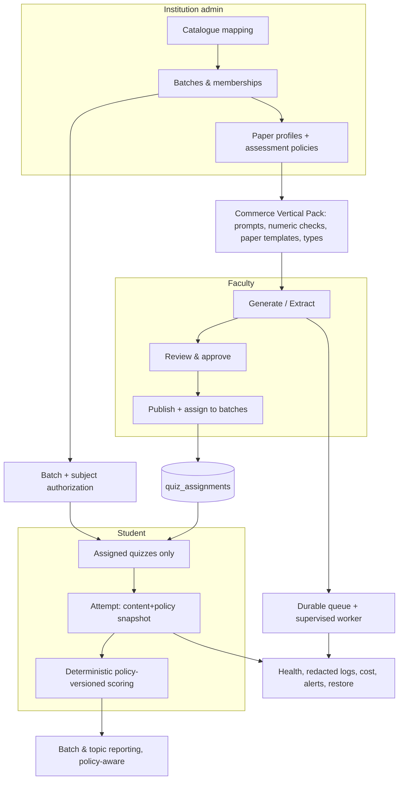
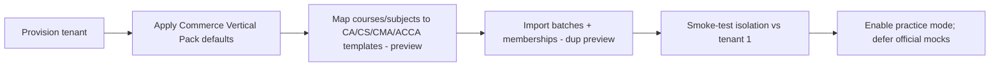

# Phase 6 — Commerce SaaS: Architecture, Workflow & Phased Roadmap

**Status:** proposed architecture for approval. No code, migration, or deployment is authorized by this document.
**Prepared:** 22 September 2026. **Companion to:** [Phase 6 Engineering Handover](phase-6-arivupro-engineering-handover.md) (that doc = principles/spec; this doc = executable architecture + sequencing).
**Goal restated:** turn the existing quiz platform into a **reusable commerce assessment vertical**, proven in Phase 1 on **two live commerce tenants** — ArivuPro (tenant 1) and one external commerce academy (first customer) — at production-SaaS quality.

This plan is grounded in a direct reading of the current code (file:line verified) and in exam-body research, not assumptions. Where the handover and reality differ, reality is cited.

---

## 1. Current state — verified, not assumed

What already exists (good news — we build on it, not from scratch):

| Capability | State today | Evidence |
| --- | --- | --- |
| Multi-tenant core | `tenant_id` on every table; RLS helpers `current_tenant_id()`, `is_staff()`, role model (super_admin/institution_admin/teacher/student) | `migrations/schema.sql` |
| Academic hierarchy | `courses → subjects → chapters → topics` | schema.sql |
| Generation | Blueprint + chunked map-reduce; durable faculty worker (opt-in) or in-process daemon threads | `blueprint.py`, `generation_jobs.py`, `faculty_worker.py` |
| Extraction | Typed (DeepSeek) + scanned (Gemini vision) import, candidate validation, receipts, source inventory | `quiz_extraction.py`, `import_fidelity.py` |
| Review/publish/reuse | Edit/approve/reject/regenerate; atomic publish; safe duplicate-to-draft with release locks | `questions.py`, `review.py`, `quiz_reuse.py`, migration 51 |
| Student delivery | Published quizzes, attempts, autosave, submit, **question snapshot frozen at attempt start** | `student.py`, migration 37 |
| Practice/Challenge | Smart/chapter/revision/**exam**/daily practice; shareable challenges; answer-leak protections | `practice.py`, `challenge.py`, `selector.py` |
| Ops | AI-call cost logging, rate limits, deployment preflight, CI | `ai_call_logging.py`, `rate_limit.py`, `deployment_check.py` |

Five findings that **change the plan** (these correct or sharpen the handover):

1. **`descriptive` is already a question type** (`schema.sql` enum) but is **always graded 0** — it is a type without a grader, not a missing type.
2. **Negative marking already exists — but only in the practice engine**, as a single **global** `config.negative_marking` applied in exam/daily mode (`practice.py`). The **quiz** grader (`student.py` → `grading.py`) is **pure full-or-zero**. So scoring is *inconsistent across two engines* and *not per-paper*.
3. **Attempt immutability is partly solved:** `question_snapshot` (jsonb) is frozen at attempt start; grading reads the snapshot, not live rows. The missing half is a **scoring-policy** snapshot.
4. **There is no batch / cohort / section concept.** Student access = *course enrollment → subjects → any published quiz in that subject*. There is **no way to assign a quiz to a specific batch** — the single biggest gap for "all batches" and for not leaking one batch's paper to another.
5. **No calculation-correctness check anywhere.** `numerical` grading is `abs(student − value) ≤ tolerance` with **no units, currency scale, or rounding**; generation validates answer *shape* only. No commerce/domain logic exists.

---

## 2. Commerce scoring reality (research) — this drives the engine design

Auto-marking rules differ **by body and by paper**, which is why a single global toggle is the wrong model:

| Body / level | Objective share | Negative marking | Partial credit | Notable types |
| --- | --- | --- | --- | --- |
| **CA Foundation** (ICAI) | Papers 3 & 4 fully objective | **−0.25 per wrong** (P3/P4 only) | No | MCQ |
| **CA Inter / Final** | 30% MCQ, 70% descriptive | **None** on MCQ | No | MCQ + descriptive |
| **CMA Foundation** (ICMAI) | 100% MCQ (2 marks each) | **None** | No | MCQ |
| **CMA Inter / Final** | ~30% MCQ, 70% descriptive | **None** | No | MCQ + descriptive |
| **CS Executive** (ICSI) | ~20% case-objective, 80% descriptive | Body-specific | No | Case MCQ + descriptive |
| **ACCA** (F2/F3 etc.) | Fully objective (Applied Knowledge) | **None** (zero for wrong) | **Yes — MRM** (multiple-response-multiple-marks) | MCQ, **multiple-response**, **number-entry (unit + rounding)**, **matching/drag-drop** |

**Engineering implications (non-negotiable):**
- Scoring must be a **per-paper policy**, snapshotted per attempt — negative marking is the *exception* (CA Foundation objective), not the default.
- **Number-entry needs a unit/currency/rounding/tolerance contract** (ACCA shows the unit outside the box; Indian papers use ₹, lakh/crore, `1,00,000` grouping).
- **Matching / drag-drop** and **assertion-reason** (common in Indian objective papers) are **missing question types**.
- **Descriptive dominates CA/CMA Inter+Final and CS** → auto-grading is out of scope; **manual/rubric grading** must be explicit, not silently zeroed.
- Most bodies have **no negative marking** → the safe default (full/zero) is correct for the majority; the engine just has to *express* the exceptions.

Sources: [ICAI CA pattern](https://www.arivupro.com/blogs/ca/icai-ca-exam-pattern), [CA Foundation negative marking](https://zeroinfy.in/blogs/cablogs/ca-foundation-exam-pattern), [CA Inter pattern](https://caexams.in/exams/ca-inter-exam-pattern), [CMA pattern](https://www.shiksha.com/accounting-commerce/accounting/cma-exam-pattern), [ICSI CS pattern](https://www.pw.live/cs/exams/icsi-cs-exam-pattern), [ACCA marking facts](https://www.zelleducation.com/blog/is-there-negative-marking-in-acca-exams/), [ACCA CBE guide](https://www.accaglobal.com/content/dam/ACCA_Global/Students/exam/Guide%20to%20CBEs_FINAL.PDF).

---

## 3. Gap analysis — what stands between "works for us" and "production commerce SaaS"

Grouped by theme, each with severity for the two-tenant Phase-1 launch.

**A. Access & tenancy (BLOCKER).** No batches, no assignments; access is course-wide. Cannot run "all batches" safely or stop batch-A's paper reaching batch-B. Needs `batches`, `batch_memberships`, `quiz_assignments`, and enforcement on **every** read path (quiz list, attempt-start, practice, challenge, direct-ID).

**B. Scoring engine (BLOCKER for "commerce").** Two divergent graders; global-only negative marking; no per-paper policy; no policy snapshot; no partial (MRM); no unit-aware numerical. Binary full/zero cannot represent commerce papers.

**C. Commerce AI quality (CORE).** Subject-neutral prompts; no numeric-correctness check; no unit/currency handling; no assessment-year/jurisdiction context; extraction not hardened for Indian number formats/tables.

**D. Question-type coverage (HIGH).** Missing matching/drag-drop, assertion-reason, MRM-partial; `descriptive` has no grading path.

**E. Productization / onboarding (BLOCKER for "SaaS").** No repeatable tenant provisioning; no "Commerce Vertical Pack" instantiation; risk of per-tenant hardcoding. Onboarding academy #2 is undefined.

**F. Reliability / security / privacy (BLOCKER for production).** Historical finding: AI logs once stored raw request/response payloads. Current code is metadata-only and migration 59 drops those columns (operator-reported applied 2026-09-24). Remaining gates include worker supervision, figure-storage hygiene, health/readiness/alerting, and provider-side retention verification.

**G. Reporting (HIGH).** No batch-level analytics, no first-attempt-vs-retry separation, no policy-aware aggregation, no per-paper exam-readiness.

---

## 4. Target architecture

Keep the current deployment units (Next.js, FastAPI, Supabase, faculty worker). **No new microservice or vector DB.** Add capability as tenant-scoped, versioned, flag-gated modules.



### 4.1 Data-model deltas (logical contracts, not final SQL)

| Entity | Purpose | Key rules |
| --- | --- | --- |
| `batches` | cohort within a course | `tenant_id`, `course_id`, name, exam-session, active dates; a branch is **not** a tenant |
| `batch_memberships` | student/teacher ↔ batch | unique (batch, profile); student in many batches; teacher access still needs subject permission |
| `paper_profiles` | commerce paper context (single active version in Phase 1) | body/level/paper, syllabus/AY, jurisdiction, framework, currency/unit conventions, supported types |
| `assessment_policies` | how a paper is *scored* | mode (practice/mock), per-type scoring, negative-marking rule, omission rule, partial rule, time/attempt limits; **immutable once released** |
| `quiz_assignments` | released quiz ↔ batch + window | idempotent; binds `assessment_policy` + availability window; scheduling never alters frozen content |
| Attempt extensions | policy snapshot | add `assessment_policy_snapshot` + engine version alongside existing `question_snapshot` |
| Question extensions | commerce metadata | `unit_contract` (for numerical), profile/version refs, numeric-check result; additive, nullable for legacy |

All new tables: `tenant_id`-scoped, RLS + grants, same-tenant composite FKs, indexed on (tenant, course/subject/batch, active).

### 4.2 The scoring engine (the core refactor — designed here because it's your top concern)

**Contract change** (unify quiz + practice behind one engine):

```
grade(question_snapshot, student_answer, policy) -> Outcome
Outcome = { state: correct | wrong | blank | needs_manual, awarded: Decimal, detail }
```

- `state` distinguishes **blank vs wrong** (required for negative marking and omission rules).
- `awarded` is **Decimal**, computed from the **policy**, not a constant.
- `needs_manual` is returned for `descriptive` (never silently 0) → routes to a manual-grading queue.

**Per-type scoring, policy-driven:**
- `mcq_single`/`true_false`: correct → `marks`; wrong → `policy.wrong_penalty` (0 for most bodies, −0.25 for CA-Foundation objective); blank → `policy.omission` (0).
- `mcq_multi`: `policy.multi_mode` ∈ {all_or_nothing (default), mrm_partial (ACCA)}. MRM awards per-correct-selection with wrong-selection cap.
- `numerical`: evaluate against a **unit contract** — declared currency/scale (₹, lakh, crore), rounding mode/stage, tolerance; **Decimal** arithmetic; `2.5 lakh == 250000` only when the contract permits; reject non-finite.
- `fill_blank`: normalized accepted set (existing) + optional numeric contract.
- `descriptive`/`matching`/`assertion_reason`: matching/assertion auto-graded by set/sequence rules; descriptive → `needs_manual`.

**Immutability & safety:**
- Snapshot the resolved `assessment_policy` + engine version at attempt start (mirrors `question_snapshot`).
- **Default policy = current full/zero, byte-identical** → legacy quizzes/practice unaffected until a paper opts into a richer policy.
- Never compare scores across incompatible policies (reporting guardrail).

This replaces both the binary quiz grader and the global-negative practice grader with one **policy-versioned** engine — the smallest change that makes commerce scoring expressible without destabilizing existing behavior.

---

## 5. Phase-by-phase roadmap

Increments are small, flag-gated, and independently shippable. **Phases 0–2 + minimal 3 = the MVP that puts two commerce tenants live in batch-scoped practice with correct scoring.** Official-pattern mocks and full type coverage are fast-follow.

| Phase | Name | Blocker? | Objective | Exit gate (evidence) |
| --- | --- | --- | --- | --- |
| **P6.0** | Foundation & de-risk | ✅ launch | Inventory schema/flags/worker; **supervise the worker** (fix silent `queued` hang); fix figure storage-orphans + signed-URL expiry; redact + set retention for AI logs; ship the **approve-all fix**; reproduce the reported timeout | Worker auto-restarts + alerts on no-heartbeat; AI logs redacted; approve-all accepts valid pending/flagged; timeout reproduced or explained |
| **P6.1** | Access: batches + assignments | ✅ launch | `batches`, `batch_memberships`, `quiz_assignments`; admin CRUD + import-preview; enforce **assignment-based** access on quiz list, attempt-start, practice, challenge, direct-ID; legacy `legacy_course` vs `assigned_batches` audience mode | Two batches in one course; cross-batch access denied; answer-embargo holds across every route incl. practice/challenge |
| **P6.2** | Scoring policy engine | ✅ launch | `assessment_policies`; unify quiz+practice behind `grade(...,policy)`; per-type + negative + MRM-partial + numeric unit contract; policy snapshot at attempt start; default = full/zero | CA-Foundation −0.25 fixture, ACCA MRM-partial fixture, ₹/lakh rounding fixture all pass; legacy full/zero byte-identical under default; policies snapshotted |
| **P6.3** | Commerce Vertical Pack (AI quality) | ◑ core | Commerce prompt modules; `paper_profiles` (single active version); numeric-check registry (interest, depreciation, ratios, break-even) at **generate-verify + grade-compare**; AY/jurisdiction context at profile/source; Indian-number/table extraction hardening | Numeric fixtures pass end-to-end; extraction preserves `1,00,000`/tables/₹; no unsupported calculator marked "passed" (`not_checked` instead) |
| **P6.4** | Question-type coverage | ◐ fast-follow | Add `matching`/`drag_drop`, `assertion_reason`, MRM; extract + generate + review + take + grade + UI for each; manual-grading queue for `descriptive` | Each new type round-trips extract→generate→review→take→grade; descriptive routes to manual, never auto-zero |
| **P6.5** | Reporting & exam-readiness | ◐ fast-follow | Batch analytics; first-attempt vs retry; policy-aware aggregation; per-topic/paper readiness; cost per usable question | Reconciled denominators; no cross-policy mixing; small-sample flags shown |
| **P6.6** | Productization & onboarding | ✅ launch | Tenant provisioning + Commerce Vertical Pack instantiation; onboard **academy #2** via runbook; per-tenant config (no hardcode); billing/quota surfacing; retention/deletion policy + restore runbook | Academy #2 onboarded via documented steps; **two-tenant isolation suite green**; restore rehearsal passes |
| **P6.7** | Hardening, load, rollout | ✅ launch | Load + restore evidence; per-paper academic acceptance; progressive all-batch rollout with rollback rehearsal | Sign-offs per enabled paper; rollback rehearsed; real faculty productivity observed |

**Dependencies:** P6.0 first (de-risk). P6.1 and P6.2 are parallelizable after P6.0. P6.3 depends on P6.1 (paper context) + P6.2 (numeric grading). P6.4/P6.5 after P6.2/P6.3. P6.6 after P6.1–P6.3. P6.7 gates go-live.

**MVP fast-lane (recommended first delivery):** P6.0 → P6.1 → P6.2 → P6.3-minimal (commerce prompts + numeric checks for the first two live papers). This is the shortest path to "two commerce tenants, batch-scoped, correctly scored." Defer P6.4 breadth, P6.5 depth, and official-pattern mocks.

---

## 6. Key workflows

**Onboard a commerce academy (repeatable — the SaaS test):**


**Faculty generate → assign:** select batch + paper (defaults from profile) → upload/select authorized source → generate (durable job, real stage) → review/edit/**approve-all** → publish + **assign to specific batches** with availability window + policy.

**Student attempt:** see **only assigned** quizzes → start (snapshot content **+ policy**) → autosave (authorized, revisioned) → submit (idempotent, server-timed) → score via **policy-versioned engine** → results per feedback-release rule.

---

## 7. Non-functional requirements (production SaaS)

- **Reliability:** supervise API + worker independently; alert on no-heartbeat / oldest-queued-age / exhausted retries; a queued submission must become a visible draft or an explicit recoverable failure (no silent hang — the exact failure we hit).
- **Security/privacy:** per-new-table RLS + service-role API authz tests; **redact AI-log payloads** by default (they contain source text); set explicit retention for documents/logs/checkpoints/attempts; two-tenant answer-leak audit across practice/challenge/PDF/lineage.
- **Testing (launch gates):** **two-tenant isolation suite**; commerce numeric fixtures (currency scale, rounding, zero denominators, non-finite, MRM); scoring regression (legacy full/zero unchanged); queue chaos (refresh/restart/crash/lease-expiry); import fidelity (Indian formats/tables/keys).
- **Observability/cost:** cost-per-usable-question and per-tenant quota surfaced; correlation IDs across API→job→provider→draft→publication.
- **Storage hygiene:** figure-object cleanup on delete/re-analyze; signed-URL TTL that survives long reviews (or same-origin proxy).

---

## 8. Risks & sequencing rationale

- **Biggest risk = the scoring refactor** (most correctness-critical file). Mitigation: contract change behind a default-preserving policy + exhaustive regression before any new policy is enabled.
- **Second = access-model change** (batches) touching every read path. Mitigation: `legacy_course` mode keeps existing quizzes behaving until explicitly migrated; strict `assigned_batches` only for new commerce quizzes.
- **Do P6.0 first** because the worker-supervision and log-redaction gaps are live production hazards independent of any feature.
- **Keep commerce AI quality (P6.3) in the MVP** — deferring it means shipping a "generic quiz tool a commerce academy uses," not the commerce platform the mandate calls for. Defer only the heavy *versioning* and *official-pattern* machinery.

---

## 9. Decisions I need from you before coding

1. **Confirm the MVP fast-lane** (P6.0 → P6.1 → P6.2 → P6.3-minimal) as the first delivery, or a different cut.
2. **First two live papers** for tenant 1 and academy #2 (e.g., CA Foundation Paper 3 + a CMA/ACCA paper) — this sizes the Commerce Vertical Pack and numeric registry.
3. **Academy #2 identity + roster source** (or a realistic stand-in) so onboarding is a *real* second tenant, not hypothetical.
4. **Practice-first confirmed** (defer official-pattern mocks)? The research says most objective papers are simple full/zero, so practice-first is low-risk.
5. **Retention periods** for AI logs / documents / attempts (needed for the privacy fix in P6.0).

On approval, I start with **P6.0** (inventory + worker supervision + log redaction + approve-all fix + storage/URL fixes) as small, reviewable, flag-gated increments — nothing touches generation, reuse, or figures destructively, and every step is verified before the next.
