# Teacher Workflow — Complete Architecture (Upload → Publish)

> **Scope.** This is the deep architectural reference for the *teacher* side of the platform — the
> heart of the product. It traces every layer (frontend → backend → services → LLM → Supabase
> storage + Postgres) for the full journey: **upload a document → extract topics → generate
> questions → review/approve/edit/regenerate → publish → make visible to students.**
>
> All names, endpoints, tables, columns, and status values below are taken from the real code
> (`backend/app/…`, `frontend/…`, `migrations/…`). Diagrams are Mermaid — they render in GitHub,
> VS Code (with a Mermaid preview extension), and most Markdown viewers.

---

## 0. The journey at a glance

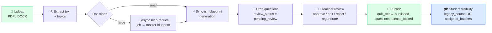

**Layer map for the whole journey**

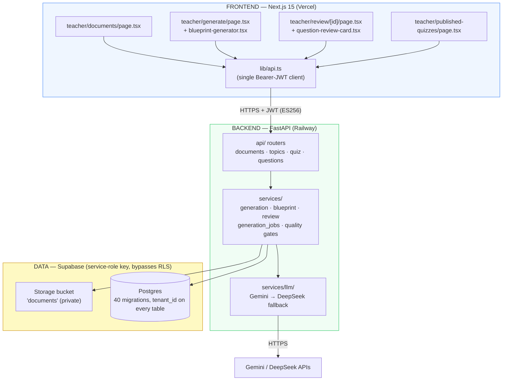

**Security spine (applies to every arrow above).** The browser holds a Supabase JWT (ES256,
verified locally against JWKS). The backend uses the Supabase **service-role key** which
*bypasses Row-Level Security*, so tenant isolation is enforced in application code — every query
filters on `tenant_id`, and the authoritative `role`/`tenant_id` come from the `profiles` table,
never from the browser. RLS policies exist as defense-in-depth (see migration-52 policies in the
batches tables). Every `/api/v1/*` response is `Cache-Control: no-store` with a strict CSP
(`backend/app/main.py:112-158`).

---

## 1. STAGE 1 — Document upload

### 1.1 Sequence (UI → storage + DB)

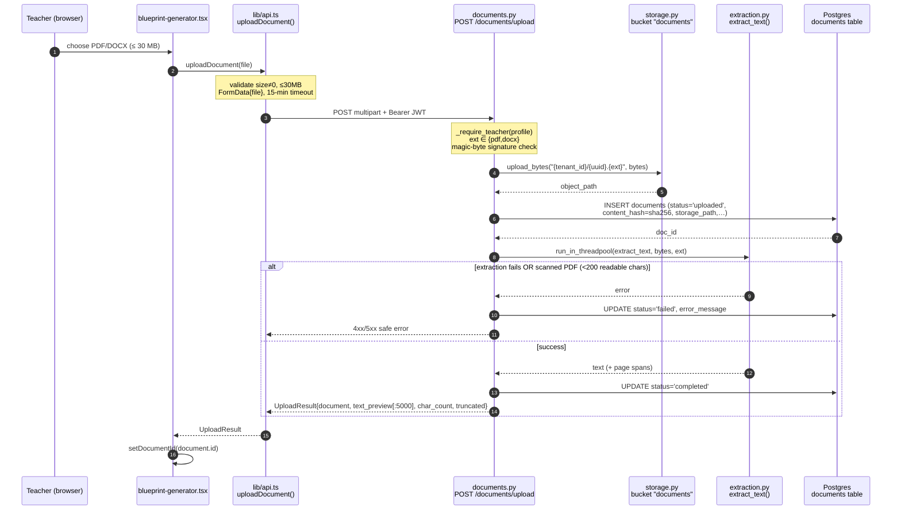

### 1.2 Exact facts

| Concern | Value | Source |
|---|---|---|
| UI entry | file input in `blueprint-generator.tsx:297-346` | frontend |
| API fn | `uploadDocument(file)` | `lib/api.ts:286-315` |
| Endpoint | `POST /api/v1/documents/upload` | `documents.py:122-237` |
| Allowed types | `pdf`, `docx` (`ALLOWED_EXT`) | `documents.py:36` |
| Max size | 30 MiB (frontend **and** backend enforced) | `api.ts:14`, `documents.py:38` |
| Upload timeout | 15 minutes | `api.ts:18` |
| Storage bucket | `documents` (private) | `storage.py:18` |
| Object path | `{tenant_id}/{uuid}.{ext}` | `documents.py:157` |
| Text extractors | **pdfplumber** (PDF), **python-docx** (DOCX) | `extraction.py:18-20` |
| Scanned-PDF guard | reject if `< 200` readable chars (`MIN_READABLE_PDF_TEXT_CHARS`) | `extraction.py:27` |
| Dedup | `content_hash` = SHA-256 of bytes; `POST /documents/check-duplicate` | migration-17, `documents.py:271-358` |
| Signed-URL TTL | 300 s (5 min) for private viewing | `documents.py:41` |

**`documents` table**
```sql
create table documents (
  id uuid primary key default gen_random_uuid(),
  tenant_id uuid not null references tenants(id),
  uploaded_by uuid references profiles(id) on delete set null,
  chapter_id uuid references chapters(id),
  storage_path text not null,           -- "{tenant_id}/{uuid}.{ext}"
  original_filename text,
  file_type text,                       -- "pdf" | "docx"
  status document_status not null default 'uploaded',  -- uploaded|processing|completed|failed|archived
  error_message text,
  created_at timestamptz not null default now()
  -- content_hash text  (added migration-17; index: idx_documents_tenant_hash)
);
```

---

## 2. STAGE 2 — Topic extraction & question generation

There are **two paths**, chosen by document size. Both end by writing the same
`quiz_sets → quiz_variants → questions → quiz_variant_questions` rows.

### 2.1 Decision + high-level flow

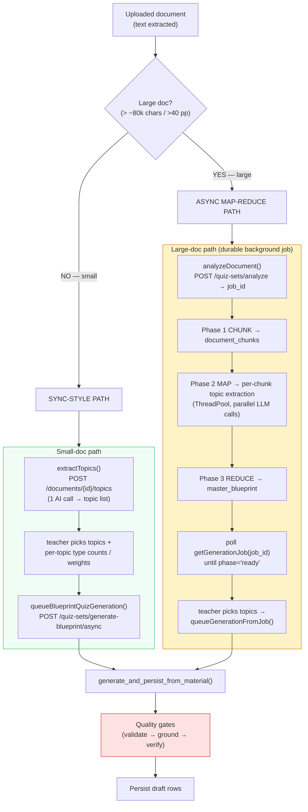

### 2.2 Small-doc generation — sequence

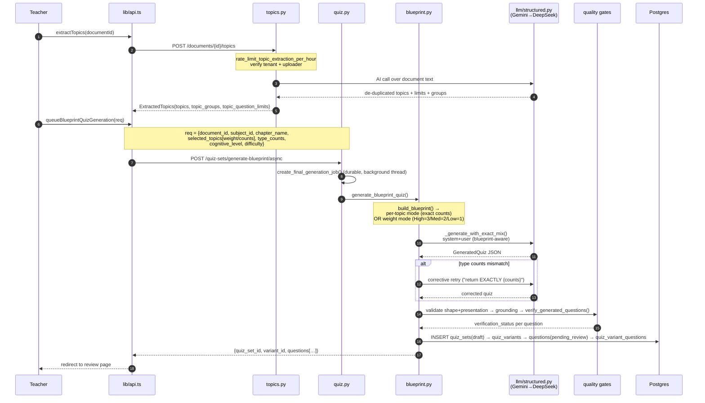

### 2.3 Large-doc map-reduce job — internals

```mermaid
flowchart LR
    subgraph JOB["GenerationJobRunner.run() — background thread"]
        direction TB
        C1["CHUNK<br/>ChunkingService.chunk_and_store()<br/>~5k-char overlapping chunks"]
        C2["→ document_chunks rows<br/>(content_hash dedup, map_status='queued')"]
        M1["MAP — TopicExtractionPipeline.run()<br/>parallel per-chunk LLM calls<br/>(MAP_SYSTEM prompt)"]
        M2["→ chunk.topics_json<br/>{definitions, formulas, worked_examples,<br/>excerpts, page_ranges}<br/>map_status='succeeded'"]
        R1["REDUCE — MasterBlueprintSynthesizer.synthesize()<br/>merge + dedup topics (REDUCE_SYSTEM prompt)"]
        R2["→ quiz_generation_jobs.master_blueprint<br/>status='completed', phase='ready'"]
        C1 --> C2 --> M1 --> M2 --> R1 --> R2
    end

    R2 --> POLL["GET /quiz-sets/generation-jobs/{id}<br/>exposes selectable topics"]
    POLL --> FINAL["QuizGeneratorService.generate_from_job()<br/>render_blueprint_material_with_evidence()<br/>→ generate_and_persist_from_material(selected_only=True)"]

    style JOB fill:#FEF3C7,stroke:#D97706
```

**Job tables (migration-31/32)**

- `quiz_generation_jobs`: `params` (jsonb), `master_blueprint` (jsonb — REDUCE output),
  `status` (`queued|running|partial|completed|failed`), `phase` (`chunking|mapping|reducing|ready`),
  `total_chunks`, `done_chunks`, `quiz_set_id` (final link), `error_message`. Resumable — retry
  re-runs only failed chunks (`POST /generation-jobs/{id}/retry`).
- `document_chunks`: `chunk_index`, `content`, `content_hash` (SHA-256, unique per doc),
  `char_start/end`, `page_start/end`, `topics_json`, `map_status` (`queued|running|succeeded|failed`),
  `attempts`.

### 2.4 The quality gate (why questions are trustworthy)

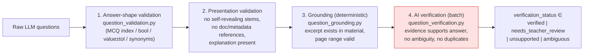

`topic_capacity.py` runs earlier (at selection time) to warn "this topic only supports ~N
questions" so teachers don't over-request.

### 2.5 LLM layer

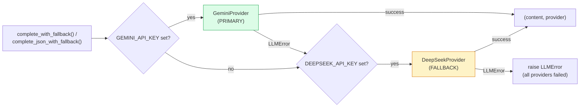

> ⚠️ **Code note:** `services/llm/__init__.py:get_providers()` and `structured.py` make **Gemini
> primary, DeepSeek fallback**. A stale docstring in `deepseek.py` calls DeepSeek "our primary
> model" — that comment is wrong; the routing is Gemini-first.

---

## 3. STAGE 3 — Teacher review (approve / edit / reject / regenerate)

Generated questions land as `review_status = 'pending_review'`. Nothing reaches students until a
teacher acts. This is the **mandatory human gate**.

### 3.1 Question status lifecycle

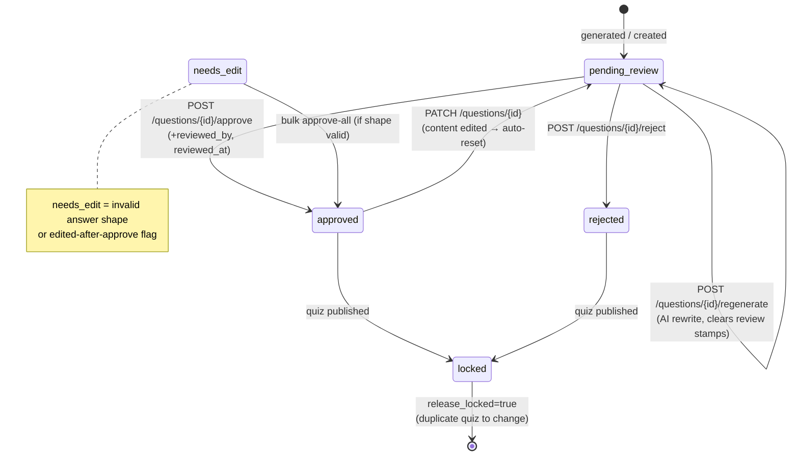

`review_status` enum (`schema.sql`): `pending_review | approved | rejected | needs_edit`.

### 3.2 Review actions → endpoints → DB writes

```mermaid
sequenceDiagram
    autonumber
    participant T as Teacher
    participant CARD as question-review-card.tsx
    participant API as lib/api.ts
    participant QN as questions.py
    participant RV as review.py
    participant LLM as Gemini→DeepSeek
    participant DB as Postgres

    rect rgb(240,253,244)
    Note over T,DB: APPROVE
    T->>CARD: click Approve
    CARD->>API: approveQuestion(id, note?)
    API->>QN: POST /questions/{id}/approve
    Note over QN: verify tenant+owner, not release_locked,<br/>answer shape valid, snapshot match (optimistic lock)
    QN->>DB: UPDATE review_status='approved', reviewed_by, reviewed_at
    QN->>DB: events INSERT (QUESTION_APPROVED)
    end

    rect rgb(254,242,242)
    Note over T,DB: REJECT
    T->>API: rejectQuestion(id)
    API->>QN: POST /questions/{id}/reject
    QN->>DB: UPDATE review_status='rejected', reviewed_by, reviewed_at
    end

    rect rgb(239,246,255)
    Note over T,DB: EDIT
    T->>API: editQuestion(id, patch, expected_version)
    API->>QN: PATCH /questions/{id}
    Note over QN: validate answer shape; optimistic version check
    QN->>DB: UPDATE fields; if content changed →<br/>review_status='pending_review',<br/>reviewed_by/at=NULL, +verification warning
    end

    rect rgb(254,249,195)
    Note over T,DB: REGENERATE (single question)
    T->>API: regenerateQuestion(id)  [60s timeout]
    API->>QN: POST /questions/{id}/regenerate
    Note over QN: enforce_ai_rate_limit(QUESTION_REGENERATE)
    QN->>RV: regenerate_question(id, tenant_id)
    RV->>RV: recover source material<br/>(master_blueprint OR document text)
    RV->>LLM: complete_with_fallback() + corrective loop
    RV->>RV: verify_generated_questions()
    RV->>DB: UPDATE content + grounding + verification,<br/>review_status='pending_review', stamps=NULL
    end
```

**The 5 `questions.py` endpoints**

| Action | Method + path | Key effect | Source |
|---|---|---|---|
| Edit | `PATCH /api/v1/questions/{id}` | selective field update; content change → resets to `pending_review` | `questions.py:137-236` |
| Approve | `POST /api/v1/questions/{id}/approve` | `approved` + stamps; optional resolution note | `questions.py:362-415` |
| Reject | `POST /api/v1/questions/{id}/reject` | `rejected` + stamps | `questions.py:418-433` |
| Regenerate | `POST /api/v1/questions/{id}/regenerate` | AI rewrite in place → `pending_review` | `questions.py:436-482` |
| Set figure | `PUT /api/v1/questions/{id}/figure` | attach/swap/remove a same-document figure | `questions.py:272-335` |

Quiz-level review endpoints (`quiz.py`): `POST /quiz-sets/{id}/approve-all` (bulk approve valid
questions, skip invalid), `POST /quiz-sets/{id}/archive`, `POST /quiz-sets/{id}/duplicate`
(idempotent copy).

---

## 4. STAGE 4 — Publish

```mermaid
sequenceDiagram
    autonumber
    participant T as Teacher
    participant API as lib/api.ts
    participant QZ as quiz.py<br/>publish_quiz_set()
    participant RPC as publish_quiz_atomic()<br/>(migration-51 PL/pgSQL)
    participant DB as Postgres

    T->>API: publishQuizSet(id, publication_token)
    API->>QZ: POST /quiz-sets/{id}/publish
    alt quiz reuse ENABLED
        QZ->>RPC: rpc("publish_quiz_atomic", id, tenant, actor, token)
        Note over RPC: atomic transaction +<br/>idempotency via token
    else reuse DISABLED
        Note over QZ: multi-statement sequence (same effect)
    end
    Note over RPC,DB: guards: teacher owns quiz;<br/>NO unresolved questions (only approved/rejected);<br/>each variant ≥1 approved question w/ positive marks
    RPC->>DB: UPDATE quiz_sets status='published', published_at=now()
    RPC->>DB: UPDATE quiz_variants total_marks = Σ approved marks
    RPC->>DB: UPDATE questions release_locked=true, content_version++
    RPC->>DB: events INSERT (quiz.published)
    RPC-->>QZ: quiz_sets row
    QZ-->>API: {id, title, status, published_at}
    API-->>T: 🎉 "Quiz published — students can now see it"
```

**What publish changes**

- `quiz_sets`: `status → 'published'`, `published_at → now()` (and `released_at` on first release).
- `quiz_variants`: `total_marks` recomputed from **approved** questions only.
- `questions` (all in the set): `release_locked → true`, `content_version` bumped. DB triggers
  `guard_released_question()` / `guard_released_structure()` (migration-51) then **prevent** any
  mutation/deletion or structural change — to edit later the teacher must **duplicate** the quiz.
- Migration-37 (`question_snapshot` on attempts) means later edits never rewrite a student's
  already-taken attempt history.

---

## 5. STAGE 5 — Student visibility (two audience modes)

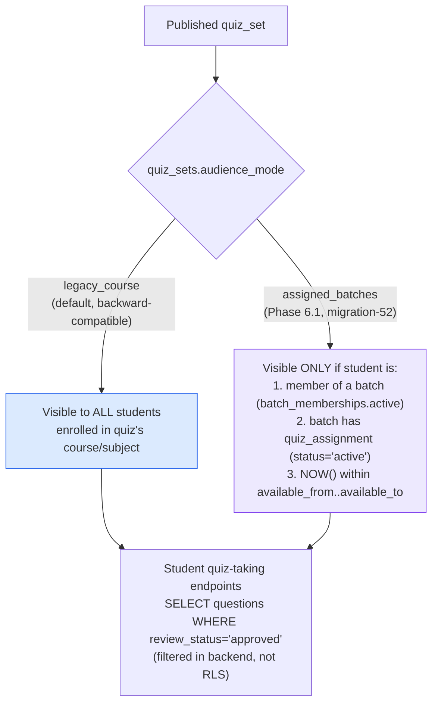

The batches feature is **flag-gated** (`BATCHES_ENABLED`, default false). Existing quizzes default
to `legacy_course`, so turning on the migration changes no current visibility until batches are
explicitly rolled out (see the migration-52 header comment).

---

## 6. Database architecture (teacher-workflow subset)

Every business table carries `tenant_id` (multi-tenant isolation in app code). Edges below are
`one —< many`.

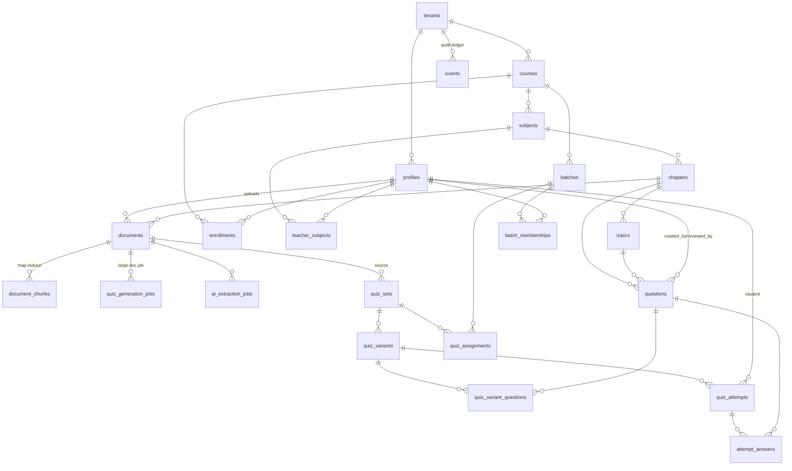

### 6.1 The four core generation tables (verbatim)

```sql
create table quiz_sets (
  id uuid primary key default gen_random_uuid(),
  tenant_id uuid not null references tenants(id),
  chapter_id uuid references chapters(id),
  subject_id uuid references subjects(id),
  document_id uuid references documents(id) on delete set null,
  title text not null,
  description text,
  status quiz_status not null default 'draft',   -- draft|published|archived
  created_by uuid references profiles(id) on delete set null,
  created_at timestamptz not null default now(),
  published_at timestamptz
  -- audience_mode text default 'legacy_course'  (migration-52)
);

create table quiz_variants (
  id uuid primary key default gen_random_uuid(),
  tenant_id uuid not null references tenants(id),
  quiz_set_id uuid not null references quiz_sets(id) on delete cascade,
  variant_type variant_type not null,            -- theory|practical|mixed
  time_limit_minutes int,
  total_marks numeric,
  created_at timestamptz not null default now()
);

create table questions (
  id uuid primary key default gen_random_uuid(),
  tenant_id uuid not null references tenants(id),
  chapter_id uuid references chapters(id),
  topic_id uuid references topics(id),
  extraction_job_id uuid references ai_extraction_jobs(id),
  type question_type not null,                   -- mcq_single|mcq_multi|numerical|true_false|fill_blank|descriptive
  question_text text not null,
  latex_content text,
  options jsonb,
  correct_answer jsonb not null,
  explanation text,
  difficulty text default 'medium',
  marks numeric not null default 1,
  source question_source not null default 'manual',   -- ai_generated|manual
  confidence_score numeric,
  source_excerpt text,                           -- verbatim evidence
  source_page_start integer,
  source_page_end integer,
  grounding_confidence numeric,                  -- 0..1
  verification_status text not null default 'needs_teacher_review',
       -- verified|needs_teacher_review|unsupported|ambiguous
  verification_warnings jsonb not null default '[]'::jsonb,
  review_status review_status not null default 'pending_review',
       -- pending_review|approved|rejected|needs_edit
  reviewed_by uuid references profiles(id) on delete set null,
  reviewed_at timestamptz,
  embedding vector(1536),                        -- semantic duplicate detection
  created_by uuid references profiles(id) on delete set null,
  created_at timestamptz not null default now()
);

create table quiz_variant_questions (
  id uuid primary key default gen_random_uuid(),
  tenant_id uuid not null references tenants(id),
  variant_id uuid not null references quiz_variants(id) on delete cascade,
  question_id uuid not null references questions(id),
  order_index int not null default 0,
  marks_override numeric,
  unique(variant_id, question_id)
);
```

---

## 7. Backend architecture (routers → services → LLM)

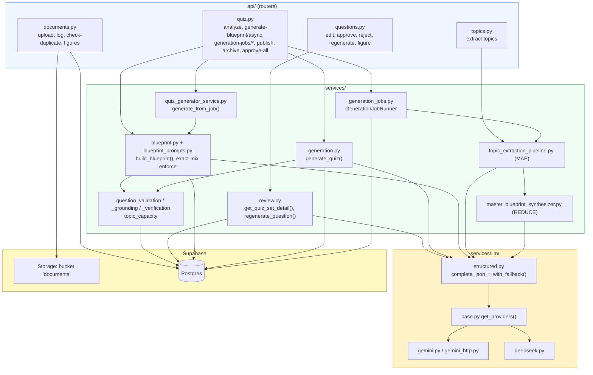

**Cross-cutting backend concerns**
- Auth: `get_current_profile` reads role/tenant from `profiles`; `_require_teacher` guards every
  teacher endpoint.
- Rate limits: `rate_limit.py` (topic extraction/hour, question regenerate/hour) backed by
  `ai_rate_limits` table.
- Audit: `events.py` appends `question.approved / rejected / regenerated`, `quiz.published`, etc.
- Durability: generation runs in a **background thread + durable job row**, so the browser can
  close mid-generation and poll the result later (this is the fix for the old synchronous 90s /
  499 / 502 timeout problem).

---

## 8. Frontend architecture (teacher surfaces)

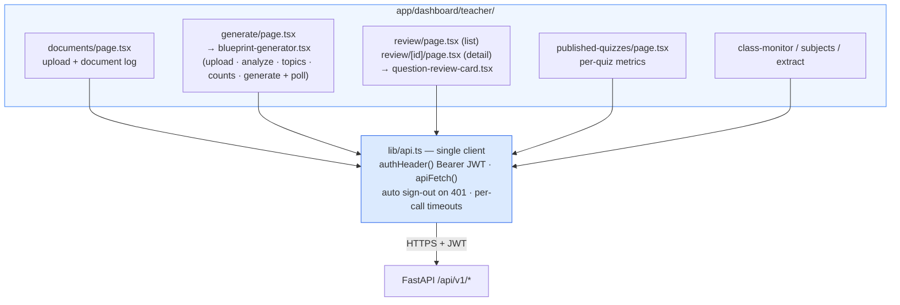

**Key `lib/api.ts` functions by stage**

| Stage | Functions |
|---|---|
| Upload | `uploadDocument`, `checkDocumentDuplicate` |
| Topics/analyze | `extractTopics`, `analyzeDocument`, `getGenerationJob`, `retryGenerationJob` |
| Generate | `queueBlueprintQuizGeneration`, `queueGenerationFromJob`, `generateFromJob` |
| Review | `getQuizSet`, `editQuestion`, `approveQuestion`, `rejectQuestion`, `regenerateQuestion`, `setQuestionFigure`, `approveAllQuestions` |
| Publish | `publishQuizSet`, `archiveQuizSet`, `duplicateQuizSet` |

---

## 9. End-to-end data lineage (one row's life)

```mermaid
flowchart LR
    F["file bytes"] -->|upload_bytes| OBJ["Storage object<br/>{tenant}/{uuid}.pdf"]
    F -->|sha256| DOC["documents row<br/>status: uploaded→completed"]
    DOC -->|chunk (large)| CH["document_chunks"]
    CH -->|MAP+REDUCE| MB["quiz_generation_jobs.master_blueprint"]
    DOC -->|LLM generate| QS["quiz_sets (draft)"]
    MB -->|LLM generate| QS
    QS --> QV["quiz_variants"]
    QS --> QN["questions<br/>pending_review"]
    QV --> QVQ["quiz_variant_questions<br/>(ordering)"]
    QN --> QVQ
    QN -->|teacher approve| QNA["questions approved"]
    QNA -->|publish| QSP["quiz_sets published<br/>questions release_locked"]
    QSP -->|legacy_course / assigned_batches| ATT["quiz_attempts + question_snapshot"]
    ATT --> ANS["attempt_answers<br/>auto-graded"]

    style QSP fill:#DCFCE7,stroke:#16A34A
    style ATT fill:#DBEAFE,stroke:#2563EB
```

---

## 10. Reference index

| Layer | Files |
|---|---|
| Upload | `frontend/lib/api.ts:286`, `backend/app/api/documents.py`, `backend/app/lib/storage.py`, `backend/app/services/extraction.py` |
| Topics | `backend/app/api/topics.py`, `backend/app/services/topics.py`, `topic_extraction_pipeline.py` |
| Generation (small) | `backend/app/api/quiz.py`, `services/generation.py`, `services/blueprint.py`, `blueprint_prompts.py`, `quiz_prompts.py` |
| Generation (large) | `services/generation_jobs.py`, `chunking_service.py`, `master_blueprint_synthesizer.py`, `quiz_generator_service.py`, `map_reduce_prompts.py`, migration-31/32 |
| Quality gates | `services/question_validation.py`, `question_grounding.py`, `question_verification.py`, `topic_capacity.py` |
| LLM | `services/llm/__init__.py`, `structured.py`, `gemini.py`, `deepseek.py` |
| Review | `frontend/.../review/[id]/page.tsx`, `components/teacher/question-review-card.tsx`, `backend/app/api/questions.py`, `services/review.py` |
| Publish | `backend/app/api/quiz.py` (publish/archive/approve-all), migration-51 (`publish_quiz_atomic`) |
| Audience | migration-52 (`batches`, `batch_memberships`, `quiz_assignments`), `quiz_sets.audience_mode` |
| Schema | `migrations/schema.sql`, migration-17/23/35/37/47/48 |

*Generated from a full read of the codebase on 2026-09-23. Line numbers reflect the state of the
`changes-pavyaa` branch at that time.*
